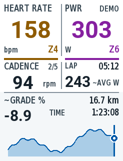

# Summit · Garmin Edge 840 全屏数据页

Monkey C / Connect IQ 数据字段。浅色大字界面，上方为带 Zone 编号与颜色的**心率、功率**；中央左侧为**踏频与较小的前/后档位**，右侧为**当前 Lap 时间与均功率估计**。底部横幅集中显示**已记录的实测海拔历史、当前位置、当前估算坡度、活动已骑距离、已耗时**。



首版已在 Edge 840 模拟器（API 6.0.0）跑通动态演示；本次新版完成 demo/live 构建及 8 项 Garmin VM、3 项 Python 测试。上图是可审阅的原生尺寸设计稿；Mac 当前锁屏，新版截图及原生 Lap 按键/自动圈联调待解锁后完成，详见 [验证记录](docs/validation.md)。[矢量源文件](docs/design/summit-history.svg)。

原生像素设计规范：[最小图元、字高、间距与对比度](docs/edge840-design-rules.md)；[246 × 322 矢量图元校准卡](docs/design/edge840-atoms.svg)。界面绘图常量集中在 `source/DisplayRules.mc`。

## 本机开发环境

- Java 17（本机已安装 Corretto 17）。
- Garmin Connect IQ SDK **9.3.0**，安装在 `~/Library/Application Support/Garmin/ConnectIQ/Sdks/`。
- `/Applications/SdkManager.app`：官方 SDK Manager。首次使用需要接受 Garmin 开发协议、登录 Garmin 账号，在 Devices 中安装 **Edge 840**。只需 Edge 设备；将 Preferences → Device Updates 设为 **Notify Me**，避免自动下载所有设备。
- Visual Studio Code + Garmin 官方 `garmin.monkey-c` 扩展。
- 项目签名密钥由首次构建生成在 `.local/developer_key.der`，已排除版本控制。后续发布时保留并备份同一个密钥。

```bash
./scripts/build.sh live     # 实机版本：bin/Summit-live.prg
./scripts/run.sh demo       # 构建并打开 Edge 840 模拟器，动态演示
./scripts/run.sh live       # 真实 Activity.Info 数据，可用模拟器模拟传感器
./scripts/run.sh test       # 在 Garmin VM 内运行 Monkey C 单元测试
python3 -m unittest discover -s tests -v
```

VS Code 中也可通过 Terminal → Run Task 选择对应的 Summit 任务。F5 运行真实数据版本。`source scripts/env.sh` 可将 `monkeyc`、`monkeydo` 加入当前终端 PATH；也可用 `CIQ_SDK_PATH` 和 `CIQ_DEVELOPER_KEY` 指定其它 SDK / 密钥。

本机的 `.vscode/settings.json` 已配置并排除版本控制。另一台电脑可复制 `.vscode/settings.example.json` 为 `.vscode/settings.json`，填入签名密钥和 **JDK 根目录**（`monkeyC.javaPath` 不是 `bin/java` 文件路径）。先运行一次 build，生成本机密钥。

模拟器请使用 **Data Fields → Layout → 1 Field**（或选择只有一个字段的全屏布局）。数据字段实际绘制尺寸以 Garmin 提供的 Dc 为准；不足一整页时会提示选择单字段布局。

## 实测海拔历史与当前位置

当前版本**只显示实际骑过并已采集的海拔**。读取 `Activity.Info.altitude / elapsedDistance`，在活动计时运行时记录，约每前进 5 m 留一个样本。最多保留 160 个实测点；达到上限后按局部三角形面积压缩，优先保留地形变化，保留首尾点，不用计划路线高度替代实测值。压缩后的轮廓是历史概览，细小起伏可能被省略。

- 从数据页加载时开始记录；中途加载不会补回此前未采集的轨迹，退出/重新加载后不恢复历史。Garmin 原生 Lap 不清空历史，活动重置才清空。
- 缺失海拔、距离、暂停或超过 5 秒的采样断流会分段，不跨缺口连线；无有效当前位置时隐藏圆点。关键状态显示 `ALT -- / DIST --`。
- 横轴显示本次已记录距离，最小跨度 100 m；纵轴按实测范围缩放，最小跨度 40 m。当前位置固定在 `x=228`，圆点白色外环最右到 `x=236`，右侧保留 **9 px 空白**。短于 100 m 的初始历史只占右侧一小段。
- 距离显示活动已骑距离，TIME 显示 `elapsedTime`（含暂停）。当前没有可靠的原生 course 总长，因此不显示总距离。
- 按当前产品选择，**暂不显示未来海拔线**，包括正在导航时。公开 DataField / Course API 无法读取正在导航的 course ID 和完整海拔点列，未来部分等待原生接口方案，不以导入 GPX 推测导航状态。

演示版通过独立的合成传感器海拔序列展示历史，标记 DEMO。实机版本无需导入 GPX。仓库中的 `scripts/import_course.py`、`CourseData.mc`、`CourseTracker.mc` 及其测试保留为旧路线原型，当前界面不调用这些路线数据或匹配逻辑。

## 踏频、档位与坡度

- 踏频直接读取 `Activity.Info.currentCadence`，单位 rpm；零踏频有效，缺失信号显示 `--`。
- 踏频标签旁边的小字为前/后档位，直接读取 `frontDerailleurIndex / rearDerailleurIndex`，如 `2/7`。需要设备已配对并能报告档位的电子变速系统；缺失位置显示 `--`，不从速度/踏频猜档位。
- `~GRADE %` 为测得海拔与活动里程差计算的平滑坡度估计：每前进 5 m 采样，使用至少 20 m 基线并平滑更新。初始数据不足、海拔缺失、停车后 15 秒没有新距离样本、重置或异常海拔跳变时显示 `--`。本实现会滞后于短促的坡度变化，尚需实骑校准。
- 演示构建的坡度、海拔、踏频和档位为独立合成数据，界面明确标记 DEMO。真实构建的坡度使用当前测得海拔。

指标来源参见 [Garmin Activity.Info 官方 API](https://developer.garmin.com/connect-iq/api-docs/Toybox/Activity/Info.html)。

## 当前 Lap：同步 Garmin 原生分圈

- 右侧 LAP 区显示当前圈计时与 `~AVG W`。接入原生 `onTimerLap2`（手动圈、设备自动圈等触发）并保留 `onTimerLap` 兼容回调；新版回调返回 true，避免 SDK 再调用旧回调而重复清零。不创建或修改 Garmin 的圈记录。
- 圈时间按原生事件收到时的 `Activity.Info.timerTime` 为起点计算，因此排除暂停；底部 TIME 使用 `elapsedTime`，含暂停。两个时间分别代表当前圈和整次活动。
- 原生公开回调只提供分圈触发信息，**不提供 Garmin 自己的当前圈均功率**。`~AVG W` 用有效功率样本按骑行计时做时间加权梯形积分；包含有效的 0 W，缺失、暂停或大于 2.5 秒的采样间隙不补值。采样、丢包、回调延迟及 Garmin 的零功率平均设置可能导致与原生均功率不一致。
- 第一次在活动开始时加载，可从 timerTime=0 统计；若在骑行中途才加载，显示 `LAP SYNC`，圈时间留空、均功率为 `--`，等下一次原生 Lap 后开始完整统计。`onTimerStart` 在中途加载也会触发，因此不能把这个事件直接当作新圈。暂停/停止后继续不清圈；活动重置才清空。
- 演示构建使用合成 Lap 时间与均功率，明确标记 DEMO。原生事件联调应运行 `./scripts/run.sh live`，实际按 Lap 键并测试设备自动圈；本次锁屏未完成这部分验证。

来源：[DataField 原生 Lap 与计时回调](https://developer.garmin.com/connect-iq/api-docs/Toybox/WatchUi/DataField.html)。

## Zone 颜色

- 功率：7 区，基于 FTP 的 55 / 75 / 90 / 105 / 120 / 150% 上限。优先读取新固件提供的骑行 FTP；无此接口或无有效值时用应用设置的 FTP（默认 250 W）。这套比例固定，不会自动读取设备自定义功率分区。
- 心率：5 区，优先读取 Garmin 用户配置的骑行心率区间；无有效配置时用设置的最大心率（默认 190 bpm）的 60 / 70 / 80 / 90% 上限。
- 颜色顺序：灰、蓝、绿、黄橙、红、紫、洋红；同时显示 Z1–Z7 / Z1–Z5，避免只靠颜色辨认。
- 传感器缺失显示灰色 `--`；零功率是有效读数。演示版使用固定 FTP / 最大心率以便可重复查看。

Garmin 模拟器可从 Simulation 菜单设置活动数据、播放 FIT 等。`demo` 构建有明确 DEMO 标记，用于布局展示，不安装到实机使用。

## Edge 840 安装

1. 构建 `./scripts/build.sh live`。
2. USB 连接 Edge 840，将 `bin/Summit-live.prg` 复制到设备 `GARMIN/APPS/`。
3. 安全弹出并启动设备，在所用骑行活动配置中添加数据页，布局设为 **1 个字段**，选择 Connect IQ → Summit。
4. 启动活动计时，数据页开始采集实测海拔历史，无需导入路线。此数据字段不负责发起导航。

## 参考

- [官方 SDK 安装](https://developer.garmin.com/connect-iq/sdk/)
- [Activity.Info：功率、心率、距离、计时与位置](https://developer.garmin.com/connect-iq/api-docs/Toybox/Activity/Info.html)
- [UserProfile：骑行心率分区与 FTP](https://developer.garmin.com/connect-iq/api-docs/Toybox/UserProfile.html)
- [Course API 的公开能力](https://developer.garmin.com/connect-iq/api-docs/Toybox/PersistedContent/Course.html)
