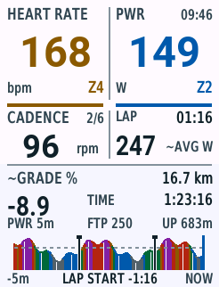

# Summit · Garmin Edge 840 全屏数据页

Monkey C / Connect IQ 数据字段。浅色大字界面，上方为带 Zone 编号与颜色的**心率、功率**；中央左侧为**踏频与较小的前/后档位**，右侧为**当前 Lap 时间与均功率估计**。右上角小字显示设备当前本地时钟（24 小时制 `HH:mm`）。底部横幅集中显示**最近 5 分钟的功率趋势、Lap 起止边界、当前估算坡度、累计爬升、活动已骑距离、已耗时**。



新版已在 Edge 840 模拟器（API 6.0.0）跑通动态功率趋势；demo/live 构建及 10 项 Garmin VM 测试通过。上图为模拟器导出的原生尺寸截图，合成数据不代表实骑；真实数据版本已验证手动 Lap 边界重置。自动圈与实机联调待完成，详见 [验证记录](docs/validation.md)。[矢量源文件](docs/design/summit-power.svg)。

原生像素设计规范：[最小图元、字高、间距与对比度](docs/edge840-design-rules.md)；[246 × 322 矢量图元校准卡](docs/design/edge840-atoms.svg)。界面绘图常量集中在 `source/DisplayRules.mc`。

## 本机开发环境

- Java 17（本机已安装 Corretto 17）。
- Garmin Connect IQ SDK **9.3.0**，安装在 `~/Library/Application Support/Garmin/ConnectIQ/Sdks/`。
- `/Applications/SdkManager.app`：官方 SDK Manager。首次使用需要接受 Garmin 开发协议、登录 Garmin 账号，在 Devices 中安装 **Edge 840**。只需 Edge 设备；将 Preferences → Device Updates 设为 **Notify Me**，避免自动下载所有设备。
- Visual Studio Code + Garmin 官方 `garmin.monkey-c` 扩展。
- 项目签名密钥由首次构建生成在 `.local/developer_key.der`，已排除版本控制。后续发布时保留并备份同一个密钥。

```bash
./scripts/build.sh live     # 实机版本：bin/Summit-live.prg
./scripts/run.sh demo       # 构建并打开 Edge 840 模拟器，动态演示
./scripts/run.sh live       # 真实 Activity.Info 数据，可用模拟器模拟传感器
./scripts/run.sh test       # 在 Garmin VM 内运行 Monkey C 单元测试
python3 -m unittest discover -s tests -v
```

VS Code 中也可通过 Terminal → Run Task 选择对应的 Summit 任务。F5 运行真实数据版本。`source scripts/env.sh` 可将 `monkeyc`、`monkeydo` 加入当前终端 PATH；也可用 `CIQ_SDK_PATH` 和 `CIQ_DEVELOPER_KEY` 指定其它 SDK / 密钥。

本机的 `.vscode/settings.json` 已配置并排除版本控制。另一台电脑可复制 `.vscode/settings.example.json` 为 `.vscode/settings.json`，填入签名密钥和 **JDK 根目录**（`monkeyC.javaPath` 不是 `bin/java` 文件路径）。先运行一次 build，生成本机密钥。

模拟器请使用 **Data Fields → Layout → 1 Field**（或选择只有一个字段的全屏布局）。数据字段实际绘制尺寸以 Garmin 提供的 Dc 为准；不足一整页时会提示选择单字段布局。

## 最近 5 分钟功率趋势与 Lap 起止

底部图改为**最近 5 分钟实测功率**，左侧为 -5m、右侧 NOW。时间轴采用 `Activity.Info.elapsedTime`，包含暂停时间；不足 5 分钟时历史从右侧逐渐铺开，不补造此前数据。每个对齐的 3 秒桶取有效功率样本均值，零功率有效；缺失、暂停或超过 2.5 秒的断流分段显示，图中空白不代表 0 W。当前未完成的桶会随新样本更新。

- 趋势轮廓和柱形使用与主功率相同的 Zone 颜色；当前主功率数字保持原始即时读数。
- **灰色横向虚线为 FTP**，图上方标明 FTP 数值；纵轴从 0 W 到至少 150% FTP，超过时按 50% FTP 逐级扩展，以免截掉高功率。
- **带顶帽的黑色竖线是原生 Lap 边界**：同一条线代表上一圈结束、新一圈开始。切圈时分开功率桶，不把两圈平均在一起。右侧蓝色竖线是 NOW，不代表圈结束。
- 图下 `LAP START -1:08` 表示当前圈起点距今 1 分 8 秒（包含暂停）；超过窗口显示 `LAP START <-5m`，不把起点错误地画在左边缘。当前圈结束位置等待下次原生 Lap，不预测。
- 只有确知活动从 0 开始，才标记首圈起点；中途加载显示 `LAP SYNC`，下一次原生 Lap 后同步。暂停/停止不伪造圈终点，活动重置才清空历史；重新加载不恢复此前未采集数据。
- 常规约 101 个桶；大量短圈/断流时最多保留 160 个桶、100 个窗口内边界，达到上限后丢弃最旧记录，内存有界。

横幅保留估算坡度、已骑距离、TIME（含暂停），并显示原生 `totalAscent` 累计爬升 `UP …m`。不需要导入 GPX。旧海拔图、GPX 和海拔历史模型保留为历史原型，当前界面不调用它们。演示版使用合成功率及每 2 分钟一次的合成 Lap；实机版只使用原生事件。

## 踏频、档位与坡度

- 踏频直接读取 `Activity.Info.currentCadence`，单位 rpm；零踏频有效，缺失信号显示 `--`。
- 踏频标签旁边的小字为前/后档位，直接读取 `frontDerailleurIndex / rearDerailleurIndex`，如 `2/7`。需要设备已配对并能报告档位的电子变速系统；缺失位置显示 `--`，不从速度/踏频猜档位。
- `~GRADE %` 为测得海拔与活动里程差计算的平滑坡度估计：每前进 5 m 采样，使用至少 20 m 基线并平滑更新。初始数据不足、海拔缺失、停车后 15 秒没有新距离样本、重置或异常海拔跳变时显示 `--`。本实现会滞后于短促的坡度变化，尚需实骑校准。
- 演示构建的坡度、海拔、踏频和档位为独立合成数据。真实构建的坡度使用当前测得海拔。

指标来源参见 [Garmin Activity.Info 官方 API](https://developer.garmin.com/connect-iq/api-docs/Toybox/Activity/Info.html)。

## 当前 Lap：同步 Garmin 原生分圈

- 右侧 LAP 区显示当前圈计时与 `~AVG W`。接入原生 `onTimerLap2`（手动圈、设备自动圈等触发）并保留 `onTimerLap` 兼容回调；新版回调返回 true，避免 SDK 再调用旧回调而重复清零。不创建或修改 Garmin 的圈记录。
- 圈时间按原生事件收到时的 `Activity.Info.timerTime` 为起点计算，因此排除暂停；底部 TIME 使用 `elapsedTime`，含暂停。两个时间分别代表当前圈和整次活动。
- 原生公开回调只提供分圈触发信息，**不提供 Garmin 自己的当前圈均功率**。`~AVG W` 用有效功率样本按骑行计时做时间加权梯形积分；包含有效的 0 W，缺失、暂停或大于 2.5 秒的采样间隙不补值。采样、丢包、回调延迟及 Garmin 的零功率平均设置可能导致与原生均功率不一致。
- 第一次在活动开始时加载，可从 timerTime=0 统计；若在骑行中途才加载，显示 `LAP SYNC`，圈时间留空、均功率为 `--`，等下一次原生 Lap 后开始完整统计。`onTimerStart` 在中途加载也会触发，因此不能把这个事件直接当作新圈。暂停/停止后继续不清圈；活动重置才清空。
- 演示构建使用合成 Lap 时间与均功率。原生事件联调运行 `./scripts/run.sh live`；已通过模拟器 Activity Data → Lap 触发并观察当前圈计时重置和边界标记，设备自动圈仍待实机验证。

来源：[DataField 原生 Lap 与计时回调](https://developer.garmin.com/connect-iq/api-docs/Toybox/WatchUi/DataField.html)。

## Zone 颜色

- 功率：7 区，基于 FTP 的 55 / 75 / 90 / 105 / 120 / 150% 上限。优先读取新固件提供的骑行 FTP；无此接口或无有效值时用应用设置的 FTP（默认 250 W）。这套比例固定，不会自动读取设备自定义功率分区。
- 心率：5 区，优先读取 Garmin 用户配置的骑行心率区间；无有效配置时用设置的最大心率（默认 190 bpm）的 60 / 70 / 80 / 90% 上限。
- 颜色顺序：灰、蓝、绿、黄橙、红、紫、洋红；同时显示 Z1–Z7 / Z1–Z5，避免只靠颜色辨认。
- 传感器缺失显示灰色 `--`；零功率是有效读数。演示版使用固定 FTP / 最大心率以便可重复查看。

Garmin 模拟器可从 Simulation 菜单设置活动数据、播放 FIT 等。`demo` 构建使用合成指标，仅用于布局展示；右上角与 live 构建一样显示真实本地时钟。实机应安装 live 构建。

## Edge 840 安装

1. 构建 `./scripts/build.sh live`。
2. USB 连接 Edge 840，将 `bin/Summit-live.prg` 复制到设备 `GARMIN/APPS/`。
3. 安全弹出并启动设备，在所用骑行活动配置中添加数据页，布局设为 **1 个字段**，选择 Connect IQ → Summit。
4. 启动活动计时，数据页开始采集功率趋势，无需导入路线。此数据字段不负责发起导航。

## 参考

- [官方 SDK 安装](https://developer.garmin.com/connect-iq/sdk/)
- [Activity.Info：功率、心率、距离、计时与位置](https://developer.garmin.com/connect-iq/api-docs/Toybox/Activity/Info.html)
- [UserProfile：骑行心率分区与 FTP](https://developer.garmin.com/connect-iq/api-docs/Toybox/UserProfile.html)
- [Course API 的公开能力](https://developer.garmin.com/connect-iq/api-docs/Toybox/PersistedContent/Course.html)
