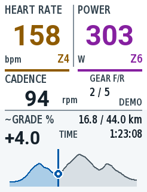

# Summit · Garmin Edge 840 全屏数据页

Monkey C / Connect IQ 数据字段。浅色大字界面，上方为带 Zone 编号与颜色的**心率、功率**；中央为**踏频**和旁边较小的**前/后档位**。底部横幅集中显示**全程海拔、当前位置、当前估算坡度、路线进度/总距离、已耗时**。



首版已在 Edge 840 模拟器（API 6.0.0）跑通动态演示；本次新版完成 demo/live 构建及 5 项 Garmin VM、3 项 Python 测试。上图是可审阅的原生尺寸设计稿；Mac 当前锁屏，新版模拟器截图验收待解锁后完成，详见 [验证记录](docs/validation.md)。[矢量源文件](docs/design/summit-v2.svg)。

原生像素设计规范：[最小图元、字高、间距与对比度](docs/edge840-design-rules.md)；[246 × 322 矢量图元校准卡](docs/design/edge840-atoms.svg)。界面绘图常量集中在 `source/DisplayRules.mc`。

## 本机开发环境

- Java 17（本机已安装 Corretto 17）。
- Garmin Connect IQ SDK **9.3.0**，安装在 `~/Library/Application Support/Garmin/ConnectIQ/Sdks/`。
- `/Applications/SdkManager.app`：官方 SDK Manager。首次使用需要接受 Garmin 开发协议、登录 Garmin 账号，在 Devices 中安装 **Edge 840**。只需 Edge 设备；将 Preferences → Device Updates 设为 **Notify Me**，避免自动下载所有设备。
- Visual Studio Code + Garmin 官方 `garmin.monkey-c` 扩展。
- 项目签名密钥由首次构建生成在 `.local/developer_key.der`，已排除版本控制。后续发布时保留并备份同一个密钥。

```bash
./scripts/build.sh live     # 实机版本：bin/Summit-live.prg
./scripts/run.sh demo       # 构建并打开 Edge 840 模拟器，动态演示
./scripts/run.sh live       # 真实 Activity.Info 数据，可用模拟器模拟传感器
./scripts/run.sh test       # 在 Garmin VM 内运行 Monkey C 单元测试
python3 -m unittest discover -s tests -v
```

VS Code 中也可通过 Terminal → Run Task 选择对应的 Summit 任务。F5 运行真实数据版本。`source scripts/env.sh` 可将 `monkeyc`、`monkeydo` 加入当前终端 PATH；也可用 `CIQ_SDK_PATH` 和 `CIQ_DEVELOPER_KEY` 指定其它 SDK / 密钥。

本机的 `.vscode/settings.json` 已配置并排除版本控制。另一台电脑可复制 `.vscode/settings.example.json` 为 `.vscode/settings.json`，填入签名密钥和 **JDK 根目录**（`monkeyC.javaPath` 不是 `bin/java` 文件路径）。先运行一次 build，生成本机密钥。

模拟器请使用 **Data Fields → Layout → 1 Field**（或选择只有一个字段的全屏布局）。数据字段实际绘制尺寸以 Garmin 提供的 Dc 为准；不足一整页时会提示选择单字段布局。

## 路线与当前位置

Garmin 的 `PersistedContent.Course` 只提供名称、ID 和启动导航等接口，**不公开当前导航路线的完整海拔点列**。本项目采用编译前导入 GPX 的方式；不会把骑行历史冒充未来路线。

```bash
python3 scripts/import_course.py /absolute/path/to/your-course.gpx
./scripts/run.sh demo
./scripts/build.sh live
```

导入文件必须是连续、带海拔的 GPX track / route。生成的 `source/CourseData.mc` 包含最多 160 个等距离采样点，控制 Edge 内存占用。当前内置 `courses/demo.gpx` 是**合成演示路线**，约 44 km、累计上升约 1052 m；不是实际道路导航文件。换成自己的 GPX 后重新编译并安装。

真实数据版本以 `Activity.Info.currentLocation` 投影到导入路线，显示路线进度；GPS 缺失显示 `GPS --`，距路线超过 150 m 显示 `OFF COURSE` 并隐藏标记。自交路段会结合上一次路线位置选择，但重叠道路、来回路线和较差 GPS 仍可能产生歧义；160 点采样也可能切掉急弯。这是原型级路线匹配，尚需实骑验证。示例路线在真实版中同样标为 `SAMPLE`，应先导入自己的路线。

设置 `courseStart` 为活动里程表中路线起点对应的米数（默认 `-1`，关闭）后，在没有可用 GPS 匹配时可使用里程估算；界面标为 `ODO EST.`。绕路时里程估算会偏离路线位置。底部的距离分子是匹配到的**路线进度**，分母是导入 GPX 的全长；位置未知时显示 `-- / 总距离`。已耗时使用 `Activity.Info.elapsedTime`（含暂停时间）。

## 踏频、档位与坡度

- 踏频直接读取 `Activity.Info.currentCadence`，单位 rpm；零踏频有效，缺失信号显示 `--`。
- 旁边的 `GEAR F/R` 直接读取 `frontDerailleurIndex / rearDerailleurIndex`，表示设备报告的前/后档位位置，如 `2 / 7`。需要设备已配对并能报告档位的电子变速系统；缺失位置显示 `--`，不从速度/踏频猜档位。
- `~GRADE %` 为测得海拔与活动里程差计算的平滑坡度估计：每前进 5 m 采样，使用至少 20 m 基线并平滑更新。初始数据不足、海拔缺失、停车后 15 秒没有新距离样本、重置或异常海拔跳变时显示 `--`。本实现会滞后于短促的坡度变化，尚需实骑校准。
- 演示构建的坡度来自导入路线的海拔剖面，演示踏频和档位为合成数据，界面明确标记 DEMO。真实构建的坡度使用当前测得海拔。

指标来源参见 [Garmin Activity.Info 官方 API](https://developer.garmin.com/connect-iq/api-docs/Toybox/Activity/Info.html)。

## Zone 颜色

- 功率：7 区，基于 FTP 的 55 / 75 / 90 / 105 / 120 / 150% 上限。优先读取新固件提供的骑行 FTP；无此接口或无有效值时用应用设置的 FTP（默认 250 W）。这套比例固定，不会自动读取设备自定义功率分区。
- 心率：5 区，优先读取 Garmin 用户配置的骑行心率区间；无有效配置时用设置的最大心率（默认 190 bpm）的 60 / 70 / 80 / 90% 上限。
- 颜色顺序：灰、蓝、绿、黄橙、红、紫、洋红；同时显示 Z1–Z7 / Z1–Z5，避免只靠颜色辨认。
- 传感器缺失显示灰色 `--`；零功率是有效读数。演示版使用固定 FTP / 最大心率以便可重复查看。

Garmin 模拟器可从 Simulation 菜单设置活动数据、播放 FIT 等。`demo` 构建有明确 DEMO 标记，用于布局展示，不安装到实机使用。

## Edge 840 安装

1. 构建 `./scripts/build.sh live`。
2. USB 连接 Edge 840，将 `bin/Summit-live.prg` 复制到设备 `GARMIN/APPS/`。
3. 安全弹出并启动设备，在所用骑行活动配置中添加数据页，布局设为 **1 个字段**，选择 Connect IQ → Summit。
4. 导航时使用与导入 GPX 一致的路线。此数据字段仅显示剖面和位置，不负责发起导航。

## 参考

- [官方 SDK 安装](https://developer.garmin.com/connect-iq/sdk/)
- [Activity.Info：功率、心率、距离、计时与位置](https://developer.garmin.com/connect-iq/api-docs/Toybox/Activity/Info.html)
- [UserProfile：骑行心率分区与 FTP](https://developer.garmin.com/connect-iq/api-docs/Toybox/UserProfile.html)
- [Course API 的公开能力](https://developer.garmin.com/connect-iq/api-docs/Toybox/PersistedContent/Course.html)
