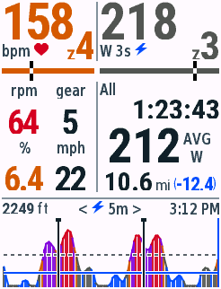

# FastRider · Garmin Edge 840 全屏数据页

Connect IQ / Monkey C 数据字段，按 Edge 840 原生 **246 × 322** 实现已确认的交互设计。只针对 Edge 840 构建；使用单字段全屏布局。



## 显示与点击

| 点击区域 | 循环切换 | 更新内容 |
| --- | --- | --- |
| 左侧心率及实时区 | **双击** | 播放以响亮蜂鸣为主的五段铃声，单击不改变数据 |
| 右上功率整块 | **3s ↔ 10s** | 平均功率数字、W 3s/10s、Zone 编号及颜色 |
| 右中统计整块 | **LAP x ↔ All** | 本圈/整次骑行的计时、平均功率、距离 mi |
| 功率图标题或曲线 | **5m → 20m → All** | 历史时间窗口与窗口内原生 Lap 起止标记 |

默认 **3s、All、5m**。点击只改变显示，不创建或清空 Lap。每次原生手动/自动分圈后，统计区自动显示最新 Lap，功率和图表范围的选择保持不变；仍可点击切回 All。活动重置恢复默认。

Garmin 从活动开始计时就进入第1圈，不需要另按 Lap。首次按 Lap 或触发自动圈会结束第1圈、开始第2圈。因此本页在第1圈先显示 All，首次分圈后自动显示 LAP 2；不会把首次按键误标成 LAP 1。左侧心率/实时区单击不切换数据；400ms内、24px内双击响铃，活动未开始或暂停时同样可用。触发后5.5秒内抑制左侧重触发，右侧与图表仍立即切换。[车铃说明](docs/bell-interaction.md)。车铃组合三次原生`TONE_LOUD_BEEP`与高/低音提示各一次，由字段每秒更新推进，约4–5秒完成发声请求；API不提供音量调节，每段实际响度与时长由设备预设决定。

左中为 **rpm、后拨 gear、估算坡度 %、实时 mph**。右中可切换本圈/整次骑行的计时、平均功率和距离。已移除功率图上的总时长，以及最底部的距离/爬升总量与剩余量一排。

功率图左侧显示累计爬升（如`1000 ft`），中央为`< ⚡ 5m >`/`< ⚡ 20m >`/`< ⚡ All >`（⚡为14×14 px蓝色矢量图标），右侧是完整AM/PM的本地12小时时钟（如`2:19 PM`），均为18 px，爬升数字加粗、ft为常规字重。爬升来自`Activity.Info.totalAscent`，米转换为英尺后取整；缺失显示`-- ft`。曲线扩展到屏幕底部，绘图区 **x4…242 / y243…319**，仅留1–2 px外边距。白底，FTP灰色虚线，Z2上限蓝色实线，原生Lap边界黑色带顶帽竖线，当前位置蓝色竖线。纵轴固定 **55%–150% FTP**；低于范围的有效功率压到底线，高于范围的功率裁到上缘；缺失/暂停断流不连接。All显示本字段采集到的整次活动历史，不会补造加载前的数据。

## 配色与数据口径

高饱和色板统一用于数字、Zone色条和功率曲线，避免同一区间在图中变成另一种色调。灰色使用纯中性灰；彩色锚点均为100% HSV饱和度，同时保留白底对比，避免浅黄和粉色。数字/区号仍可直接判断状态。

| 颜色 | 色值 | 用途 |
| --- | --- | --- |
| 中性灰 | `#555555` | 功率Z1/Z3，心率Z1 |
| 蓝 | `#004CFF` | 功率Z2，心率Z2，Z2辅助线 |
| 绿 | `#008A20` | 心率Z3 |
| 橘 | `#D05A00` | 功率Z4，心率Z4，坡度>5% |
| 红 | `#D00020` | 功率Z6/Z7，心率Z5，坡度>10%，踏频<70 |
| 紫 | `#8000D8` | 功率Z5，坡度>15%，踏频>100 |

功率图填充为90%不透明，曲线实色；FTP、Z2和Lap辅助线周围保留白色留边。色值是应用输入，设备会按屏幕格式量化；户外背光和屏幕实际色感需真机观察。

- 功率 Zone 上限为 FTP 的 55/75/90/105/120/150%。显示分组为 **Z1+Z3 灰、Z2 蓝、Z4 橘、Z5 紫、Z6+Z7 红**；实时功率与图中对应同组色系。图填充相当于白底 90% 不透明度，辅助线不透明。
- 两条实时 Zone 色条上的黑白竖线表示当前值在**当前编号 Zone**内的位置，左端为下限、右端为上限；跨区后回到新区左端，缺失数据时隐藏。功率使用正在显示的 3s/10s 平均值，不按合并配色组计算。心率使用原生首区下限和末区上限，无原生区间时首区从 0 起、末区到设置的最大心率；功率首区从 0 W 起。Z7（>150% FTP）没有有限上界，标记固定在右端。
- 心率独立使用五区：灰、蓝、绿、橘、红。优先采用原生骑行心率区间，否则用应用最大心率设置的 60/70/80/90%。
- 坡度 **>5% 橘，>10% 深红，>15% 深紫**；其余原色。坡度根据实测海拔/里程估计，不是 Garmin 原生 grade 字段。
- 踏频 **<70 深红、70–100 原色、>100 深紫**。零踏频有效；缺失显示 `--`。
- FTP 优先读 `UserProfile.getFunctionalThresholdPower(SPORT_CYCLING)`，无有效值时使用应用设置，默认 250 W。
- 3s/10s 为相应时间窗内有效采样均值，包含 0 W；缺失、暂停及超过 2.5 秒的断流清掉滑动窗口，不显示旧平均值。
- 圈时间/距离同步原生 Lap 回调。圈均功率是按有效采样时间加权的估计，**不是 Garmin 的原生圈均功率字段**；可能受丢包与原生零功率平均设置影响。All 均功率优先使用 Garmin 的 `Activity.Info.averagePower`。
- 圈时间和 All 统计时间使用 `timerTime`，不含暂停。图表时间轴使用 `elapsedTime`，包含暂停；图头不再显示总耗时。中途加载无法知道原生圈号、圈起点，显示 `LAP ?` 与 `--`；下一次原生 Lap 起获得完整圈内统计，圈号仍未知，不编造编号。
- 后拨 gear 读取 `rearDerailleurIndex`，需要电子变速传感器；不推测档位。

## 本地开发与运行

已配置 Java 17、Connect IQ SDK 9.3.0、Edge 840 官方设备包和 VS Code Garmin 扩展。只需安装 Edge 设备包，不需要下载全部设备。

```bash
./scripts/build.sh live     # bin/FastRider-live.prg：真实 Activity.Info
./scripts/run.sh demo       # 合成指标与历史，便于看布局和点击
./scripts/run.sh live       # 真实数据版本；模拟器 Activity Data → Start
./scripts/run.sh test       # Garmin VM 测试
python3 -m unittest discover -s tests -v
```

`source scripts/env.sh` 可加入 SDK 命令路径。`CIQ_SDK_PATH` 和 `CIQ_DEVELOPER_KEY` 可覆盖默认路径。签名密钥在 `.local/developer_key.der`，不提交 Git；`bin/` 同样排除。保留密钥用于后续更新。

模拟器选择 **Data Fields → Layout → 1 Field**。原生字段每秒重绘，点击模式立即更新模型，但画面可能等待下一次绘制；验收应在下一帧观察，避免把上一帧误认为未响应。

## 字体与历史内存

为保持小屏可读性，使用与矢量稿对应的16组精简位图字体，主信息为58/54/44/38/36/32 px，其他字库用于小Z、常规单位、剩余距离与窄列回退。已提交生成后的字形资源，日常构建无需 Pillow。 图形使用`Dc.setAntiAlias(true)`；自定义字库以黑底灰度PNG保存覆盖率，并以`antialias="true"`导入，文字按白色页面背景混合，并使用自动生成的真实字形边界裁剪，避免白底逻辑行框遮挡相邻文字。直线、色条和竖向标记继续落在整数像素上。参见[Garmin字体资源说明](https://developer.garmin.com/connect-iq/articles/core-topics/Resources.html#fonts)和[图形抗锯齿说明](https://developer.garmin.com/connect-iq/articles/core-topics/Graphics.html#anti-aliasing)。重新生成需 Pillow 和 SDK 自带字体：

```bash
python3 scripts/generate-fonts.py
```

上下两条竖分隔统一位于x107（左移15 px），左侧可用103 px、右侧133 px，功率起点x111；点击右区从x109开始，车铃只占x<107。外边距2 px，心率/功率主数字可见顶边距离屏幕2 px。Zone由16 px加厚小Z和44 px区号组成（可见字高约12/32 px），合计宽度31 px；baseline66保留雷达空间。单位文字和紧邻的红心/闪电在baseline62。四位功率回退36 px时，Zone改用10 px加厚小Z和26 px区号，合计宽度20 px。位置标记扩大到4×22 px：上/下各8 px黑色、中段穿过6 px色条处为白色。中间区上边界移至y91，实时信息与统计行间距增大，时长/均功率/距离之间的可见空隙更均匀。

心率三位数仍为58 px，实时四格仍为38 px；仅分别收紧3/2 px字符间距，字形像素与粗细保持相同。左侧列中心x27/x79，右侧均功率和里程整组在x111…244居中，数字与单位保留3 px空隙。字体回退条件沿用原118 px文字预算，避免同一值因换布局而突然变大。

中间四格38 px加粗、均功率54 px、统计时间/距离32 px，其他标签、单位、图头范围和时钟18 px。窄格优先完整大字整数，例如22.4 mph显示22，6.4%仍保留小数。

All模式在Garmin提供有效命名导航目标及剩余距离时追加蓝色剩余距离，如`10.7mi(-9.9)`；数字与负号使用24 px粗体，括号使用常规字重，高度介于已骑行数字和mi单位之间，不重复mi。无有效导航数据或Lap模式时隐藏。公开API无法严格识别active course ID，因此沿用有效导航目标作为可用性判据。窄列先按32/24、30/22、26/21 px成对回退，后缀及mi单位适当收紧字间距，保留原始字形比例，优先保留一位小数；特别长的值才取整，极端无法容纳时省略后缀。

统计区的 All / Lap 平均功率均使用加粗字体，四位数回退仍加粗。主数字超长时使用较小数值字体；窄格坡度/速度优先去掉小数，不压缩字形。统计时间过长则使用 30/26 px 的回退字体。全屏尺寸以 Dc 为准，非全屏布局显示 `1 field` 提示。

历史分为 3 秒/5 分钟、12 秒/20 分钟和自适应整次骑行三层，各最多 160 个桶。整次骑行层逐步合并桶，保留活动开始的数据及有效样本总和/数量；混合断流的桶不连接邻点。长时间压缩不保证分辨每个短暂断点。原生 Lap 标记最多保留 100 个，窗口外不绘制；高频碎片极端情况下，近期两层达到上限会丢弃最旧碎片。

## 安装到 Edge 840

1. `./scripts/build.sh live`。
2. USB 连接，将 `bin/FastRider-live.prg` 复制到设备 `GARMIN/APPS/`。
3. 在骑行活动中添加 Connect IQ → FastRider，设为单字段全屏。
4. 开始活动计时。live 不包含演示数据，不需要导入 GPX。

[验证记录](docs/validation.md) · [原生像素规则](docs/edge840-design-rules.md) · [批准的矢量稿](docs/design/summit-interactive.svg) · [All 模式截图](docs/summit-edge840-v02-all.png)

官方依据：[Activity.Info](https://developer.garmin.com/connect-iq/api-docs/Toybox/Activity/Info.html)、[DataField 回调](https://developer.garmin.com/connect-iq/api-docs/Toybox/WatchUi/DataField.html)、[DataField 点击委托](https://developer.garmin.com/connect-iq/articles/core-topics/Native_Controls.html)。
