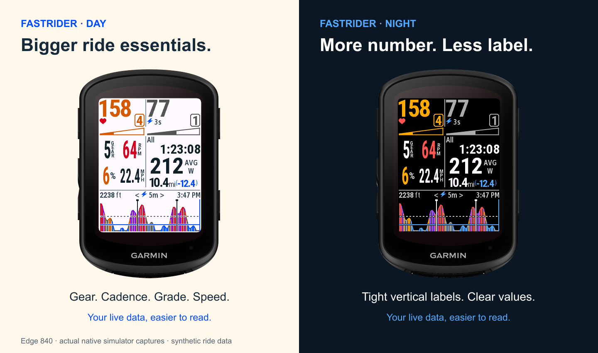
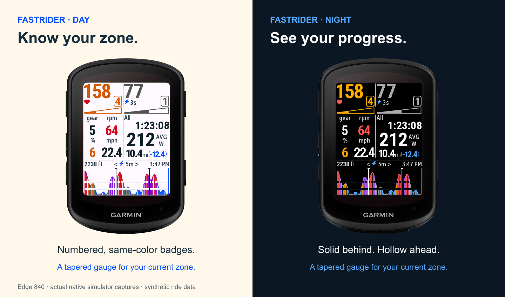

# FastRider

**English** · [简体中文](README.zh-CN.md)

[](#download)

**Power, heart rate, lap stats and your ride essentials — on one screen.**

A free, open-source Connect IQ data field for **12 Garmin Edge models**. Built for readable ride data, steady Z2 sessions and long threshold intervals.

**[Download](#download)** · [Install](#install) · [Controls](#controls) · [Build from source](#develop) · [Contribute](#contribute)

## For riders

- **See the essentials together.** Large heart rate and power, rear gear, cadence, grade, speed, lap/ride statistics and total ascent.
- **Recognize your effort.** Numbered zone badges and tapered progress gauges for heart rate and power; matching colors in the power graph.
- **Review an interval at a glance.** Z2 and FTP guide lines, native lap markers, and 5-minute, 20-minute or whole-ride history.
- **Ride through day and night.** Follows your Edge's display mode, with a bright-on-black night palette and matching zone colors.
- **Tap for a bell.** A two-second, three-strike electronic bell effect on supported touch models, even without a native bike-bell feature.

<table>
<tr>
<td width="50%"><a href="store/campaign/v0.4.1/upload/04-screen-01-one-screen.jpg"></a></td>
<td width="50%"><a href="store/campaign/v0.4.1/upload/04-screen-02-touch-bell.jpg"></a></td>
</tr>
</table>

### A graph built around your effort

**Z2 stays blue; threshold stays orange.** In the power graph, Z2 spans above 55% through 75% of FTP, and Z4 spans above 90% through 105%. A change in color makes a change in effort easier to spot. The guide lines and native lap markers help you review steady endurance work or a session such as 3 × 20 minutes.

<table>
<tr>
<td width="50%"><a href="store/campaign/v0.4.1/upload/04-screen-03-z2-training.jpg"></a></td>
<td width="50%"><a href="store/campaign/v0.4.1/upload/04-screen-04-threshold-intervals.jpg"></a></td>
</tr>
</table>

Power colors: **gray Z1/Z3 · blue Z2 · orange Z4 · purple Z5 · red Z6/Z7**. Heart-rate zones are independent; cadence and grade use their own alerts. These are visual training guides, not a workout controller.

*Illustrations show an Edge 840 with actual simulator-rendered UI and synthetic ride data. Open an image for the full-size version.*

### Bigger live data, tighter labels

Gear, cadence, grade and speed use taller bold numerals in the left-side 2×2 grid. GEAR, RPM and MPH stack beside their values; the percent sign is larger than those labels. Speed keeps one decimal, grade stays rounded, and long readings select a narrower face to stay in their own cell. The riding statistics, Zone display and graph remain in place.

[](docs/validation/live-cells/v0.4.5/README.md)

### Know your zone at a glance

Heart rate and power each show a number inside a matching-color rounded badge. The gauge grows thicker from left to right: the solid section shows your progress through the current zone, and the hollow section shows what remains before its upper boundary. Missing readings show dashes and an unfilled gauge. Zone boundaries and colors are unchanged.

[](docs/validation/zones/v0.4.4/README.md)

### Day and night, automatically

FastRider follows the Edge data-field background. Set the device's display mode to **Auto** to follow Garmin's own day/night schedule, or choose day/night manually on the device. The next redraw uses the selected theme; ride history and your selected views continue uninterrupted. Night colors are brighter, while power/heart-rate zone meanings stay the same. Font antialiasing, guide halos and zone markers use the current background too.

[](docs/validation/themes/v0.4.2/README.md)

### Your ride, when you pause

Stop the activity timer or trigger Auto Pause to see a dedicated ride summary. Total ride time and the current clock sit at the top. The narrower left column shows current heart rate, average heart rate, average watts and local NP. The right column shows distance, ascent, native average cadence and native average speed. The compact power graph below keeps its centered range selector. Resume the timer to return to the riding dashboard with your selected views intact. This automatic switch also works on button-only devices.

NP needs 30 seconds of observed power. It includes valid zero watts and excludes paused time. A mid-ride load or missing samples shows **NP est. W**; unavailable values show dashes. It is calculated locally and can differ from Garmin's post-ride NP. Average heart rate and ride-average power use Garmin's native statistics when available. There is no Moving field.

[](docs/validation/summary/v0.4.6/README.md)

## Download

<!-- downloads:start -->
Current version: **v0.4.6**. No SDK or Java needed to install. Choose a PRG to copy directly, or a ZIP with the same program, installation instructions and licenses.

| Device | Native resolution | Interaction | Direct PRG | ZIP |
| --- | --- | --- | --- | --- |
| Edge 530 | 246×322 | Fixed default view | [PRG](https://github.com/zhilichen/garmin-fast-rider/raw/refs/heads/main/releases/v0.4.6/edge530/FastRider.prg) | [ZIP](https://github.com/zhilichen/garmin-fast-rider/raw/refs/heads/main/releases/v0.4.6/edge530/FastRider-0.4.6-edge530.zip) |
| Edge 540 | 246×322 | Fixed default view | [PRG](https://github.com/zhilichen/garmin-fast-rider/raw/refs/heads/main/releases/v0.4.6/edge540/FastRider.prg) | [ZIP](https://github.com/zhilichen/garmin-fast-rider/raw/refs/heads/main/releases/v0.4.6/edge540/FastRider-0.4.6-edge540.zip) |
| Edge 550 | 420×600 | Fixed default view | [PRG](https://github.com/zhilichen/garmin-fast-rider/raw/refs/heads/main/releases/v0.4.6/edge550/FastRider.prg) | [ZIP](https://github.com/zhilichen/garmin-fast-rider/raw/refs/heads/main/releases/v0.4.6/edge550/FastRider-0.4.6-edge550.zip) |
| Edge 830 | 246×322 | Touch controls + bell | [PRG](https://github.com/zhilichen/garmin-fast-rider/raw/refs/heads/main/releases/v0.4.6/edge830/FastRider.prg) | [ZIP](https://github.com/zhilichen/garmin-fast-rider/raw/refs/heads/main/releases/v0.4.6/edge830/FastRider-0.4.6-edge830.zip) |
| Edge 840 | 246×322 | Touch controls + bell | [PRG](https://github.com/zhilichen/garmin-fast-rider/raw/refs/heads/main/releases/v0.4.6/edge840/FastRider.prg) | [ZIP](https://github.com/zhilichen/garmin-fast-rider/raw/refs/heads/main/releases/v0.4.6/edge840/FastRider-0.4.6-edge840.zip) |
| Edge 850 | 420×600 | Touch controls + bell | [PRG](https://github.com/zhilichen/garmin-fast-rider/raw/refs/heads/main/releases/v0.4.6/edge850/FastRider.prg) | [ZIP](https://github.com/zhilichen/garmin-fast-rider/raw/refs/heads/main/releases/v0.4.6/edge850/FastRider-0.4.6-edge850.zip) |
| Edge 1030 | 282×470 | Touch controls + bell | [PRG](https://github.com/zhilichen/garmin-fast-rider/raw/refs/heads/main/releases/v0.4.6/edge1030/FastRider.prg) | [ZIP](https://github.com/zhilichen/garmin-fast-rider/raw/refs/heads/main/releases/v0.4.6/edge1030/FastRider-0.4.6-edge1030.zip) |
| Edge 1030 Bontrager | 282×470 | Touch controls + bell | [PRG](https://github.com/zhilichen/garmin-fast-rider/raw/refs/heads/main/releases/v0.4.6/edge1030bontrager/FastRider.prg) | [ZIP](https://github.com/zhilichen/garmin-fast-rider/raw/refs/heads/main/releases/v0.4.6/edge1030bontrager/FastRider-0.4.6-edge1030bontrager.zip) |
| Edge 1030 Plus | 282×470 | Touch controls + bell | [PRG](https://github.com/zhilichen/garmin-fast-rider/raw/refs/heads/main/releases/v0.4.6/edge1030plus/FastRider.prg) | [ZIP](https://github.com/zhilichen/garmin-fast-rider/raw/refs/heads/main/releases/v0.4.6/edge1030plus/FastRider-0.4.6-edge1030plus.zip) |
| Edge 1040 | 282×470 | Touch controls + bell | [PRG](https://github.com/zhilichen/garmin-fast-rider/raw/refs/heads/main/releases/v0.4.6/edge1040/FastRider.prg) | [ZIP](https://github.com/zhilichen/garmin-fast-rider/raw/refs/heads/main/releases/v0.4.6/edge1040/FastRider-0.4.6-edge1040.zip) |
| Edge 1050 | 480×800 | Touch controls + bell | [PRG](https://github.com/zhilichen/garmin-fast-rider/raw/refs/heads/main/releases/v0.4.6/edge1050/FastRider.prg) | [ZIP](https://github.com/zhilichen/garmin-fast-rider/raw/refs/heads/main/releases/v0.4.6/edge1050/FastRider-0.4.6-edge1050.zip) |
| Edge 1060 | 480×800 | Touch controls + bell | [PRG](https://github.com/zhilichen/garmin-fast-rider/raw/refs/heads/main/releases/v0.4.6/edge1060/FastRider.prg) | [ZIP](https://github.com/zhilichen/garmin-fast-rider/raw/refs/heads/main/releases/v0.4.6/edge1060/FastRider-0.4.6-edge1060.zip) |

[All devices ZIP](https://github.com/zhilichen/garmin-fast-rider/raw/refs/heads/main/releases/v0.4.6/FastRider-0.4.6.zip) · [SHA256 checksums](releases/v0.4.6/SHA256SUMS) · [Release manifest](releases/v0.4.6/manifest.json)
<!-- downloads:end -->

Choose the file for your **exact device model**. Solar variants follow the matching Garmin device package. Every model uses a **one-field, full-screen** activity page.

These direct downloads are ready to sideload and include the latest changes. The [Connect IQ listing](https://apps.garmin.com/apps/ba487f91-82ad-4baa-94f0-9002f86d6a53) shows Garmin Store availability; sideload and Store versions may differ.

## Install

1. Download your model's **PRG**, or unzip its **ZIP** and find `FastRider.prg` inside the model folder.
2. Connect the Edge in USB/computer mode. Copy that file to the device's internal `GARMIN/APPS/` folder. On macOS, use an MTP-capable file-transfer application if the Edge is not shown as a mounted drive.
3. Disconnect USB. In your cycling profile, add/select **Connect IQ → FastRider** on a data page and set its layout to **one field**.

For an update, replace the existing file **using its existing filename**. Early installations may use `SUMMIT.PRG`; rename the new download to that name before replacing it. New installations use `FastRider.prg`.

Pair the sensors that supply the values you want to see. Power, heart rate, cadence and rear gear require compatible data sources; rear gear needs electronic-shifting data. Missing values display dashes. Current units are **mi, mph and ft**.

## Controls

The initial view is **3s power / All ride / 5m graph**.

| Touch area | Gesture | Result |
| --- | --- | --- |
| Top-right power | Tap | 3s ↔ 10s average |
| Right-side statistics | Tap | All ride ↔ current lap |
| Graph or its range label | Tap | 5m → 20m → All |
| Left heart-rate/live-data area | Double-tap | Two-second electronic bell |

Touch models select the newest lap after a native manual or automatic lap boundary. Garmin begins the activity in lap 1; the first completed lap starts lap 2. FastRider initially shows **All**.

**Edge 530, 540 and 550 keep the fixed 3s / All / 5m view.** They have no touch controls or electronic bell; lap boundaries still appear in the graph. Bell sound and loudness depend on device tone support. The effect uses device tones, not Garmin's native bike-bell function.

[View the touch-control card](store/campaign/v0.4.1/upload/04-screen-06-tap-controls.jpg) · [View the color guide](store/campaign/v0.4.1/upload/04-screen-05-color-coded.jpg)

### What the numbers mean

| Value | Source and behavior |
| --- | --- |
| FTP / heart-rate zones | Cycling profile when available, with app-setting fallbacks. Default fallback FTP: 250 W. |
| Power | Valid zero watts are included. Missing, paused or interrupted samples do not reuse an old average. |
| All / Lap average power | All prefers Garmin's ride average. Lap is estimated locally and can differ from Garmin's own lap statistic. |
| Time | Statistics exclude paused time; the graph's elapsed-time axis includes it. |
| Grade / remaining distance | Grade is estimated from altitude and distance. Remaining distance appears when Garmin supplies a valid named navigation destination. |
| History | Starts when the field runs. Earlier ride samples, future course elevation and an already-started lap's full state cannot be reconstructed. |

### See your device

The layout uses four display profiles, with larger numeric fonts on larger screens. **All 12 models have native simulator captures**; this is not a claim of physical-device testing on every model.

<details>
<summary><strong>Expand the 12-model native screenshot gallery</strong></summary>

<!-- screenshots:start -->
Native day-mode simulator captures, using synthetic data. Previews share a display width while keeping their aspect ratio; open an image to inspect native pixels.

| Edge 530 | Edge 540 | Edge 550 |
| --- | --- | --- |
| <a href="docs/validation/screens/edge530.png"></a> | <a href="docs/validation/screens/edge540.png"></a> | <a href="docs/validation/screens/edge550.png"></a> |

| Edge 830 | Edge 840 | Edge 850 |
| --- | --- | --- |
| <a href="docs/validation/screens/edge830.png"></a> | <a href="docs/validation/screens/edge840.png"></a> | <a href="docs/validation/screens/edge850.png"></a> |

| Edge 1030 | Edge 1030 Bontrager | Edge 1030 Plus |
| --- | --- | --- |
| <a href="docs/validation/screens/edge1030.png"></a> | <a href="docs/validation/screens/edge1030bontrager.png"></a> | <a href="docs/validation/screens/edge1030plus.png"></a> |

| Edge 1040 | Edge 1050 | Edge 1060 |
| --- | --- | --- |
| <a href="docs/validation/screens/edge1040.png"></a> | <a href="docs/validation/screens/edge1050.png"></a> | <a href="docs/validation/screens/edge1060.png"></a> |

[More states, native captures and validation notes](docs/screenshots.md)
<!-- screenshots:end -->

</details>

## Develop


**Change the metrics and design in shared code.** Model-specific differences live in the device catalog; layouts and font resources are generated by display profile. Adding an existing screen size should not require a separate renderer.

### Start locally

Install the official [Connect IQ SDK Manager](https://developer.garmin.com/connect-iq/sdk/), **JDK 17**, Bash and **Python 3.10+**. Download only the Edge device packages you need. The documented build/simulator workflow has been exercised on macOS.

```bash
git clone https://github.com/zhilichen/garmin-fast-rider.git
cd garmin-fast-rider

./scripts/check-env.sh edge840
./scripts/build.sh live edge840
./scripts/run.sh demo edge840
```

The production output is `bin/edge840/FastRider-live.prg`. `demo` uses synthetic data; use `live` to read real activity information. Normal app builds use committed font resources and do not require the marketing-image tools.

The scripts discover the SDK Manager's selected SDK, or accept `CIQ_SDK_PATH`, `CIQ_HOME` and `JAVA_HOME`. The first build creates a local signing key in ignored `.local/developer_key.der`; `CIQ_DEVELOPER_KEY` selects an existing key. Keep the same key for updates. Use your own app ID and key when publishing a separate fork.

### Where to make a change

| Change | Shared source |
| --- | --- |
| Metrics, power windows, lap statistics, history | [source/model](source/model/) |
| Activity sampling and drawing | [FastRiderView.mc](source/app/FastRiderView.mc) |
| Zone colors and alerts | [DisplayRules.mc](source/ui/DisplayRules.mc) |
| Native day/night theme and graph contrast | [DisplayTheme.mc](source/ui/DisplayTheme.mc) |
| Default views, tap regions and lap behavior | [InteractionState.mc](source/ui/InteractionState.mc) |
| Touch/bell or button-only entry points | [source/input](source/input/) |
| Positions and spacing | [design/layout.json](design/layout.json) |
| Models, display profiles and capabilities | [config/devices.json](config/devices.json) |

After layout/catalog changes, run `python3 scripts/generate-project.py`. For a new font size or resolution, run `python3 scripts/generate-fonts.py` first, then regenerate the project. Generated layouts live in `config/display/`; native font resources live in `resources/fonts/`.

### Validate a change

```bash
# SDK-free source, font, download and recorded-image checks
python3 -m pip install -r requirements-dev.txt
python3 scripts/generate-project.py --check
python3 scripts/check-downloads.py
python3 scripts/check-generated-fonts.py
python3 -m unittest discover -s tests/python -v

# Native tests for one target
./scripts/run.sh test edge840

# All configured devices (macOS; close other CIQ simulators first)
source scripts/env.sh
python3 scripts/test-matrix.py
```

For UI changes, build a deterministic capture with `./scripts/build.sh snapshot edge840`, run it in the simulator and export the **native screen**. Also inspect long values, missing sensors and affected display profiles. The approved 840 baseline has 12 view combinations; intentional design changes should update it explicitly.

**v0.4.6**: Two-column paused summary with eight ride metrics, time on top and a compact graph. 510 native test executions across 12 models, with unchanged Edge 840 riding pixels. [Summary validation](docs/validation/summary/v0.4.6/README.md).

**v0.4.5**: Larger live numerals and tight vertical labels. 489 native test executions across 12 models; pixels outside the live cells and the stopped view are unchanged. [Live-cell validation](docs/validation/live-cells/v0.4.5/README.md).

**v0.4.4**: Number-only zone badges and tapered solid/hollow gauges. 465 native test executions across 12 models; pixels outside the Zone regions and the stopped view are unchanged. [Zone validation](docs/validation/zones/v0.4.4/README.md).

**v0.4.3**: Dedicated paused/stopped summary, 441 native test executions across all 12 models, and unchanged Edge 840 day/night riding pixels. [Summary validation](docs/validation/summary/v0.4.3/README.md).

**v0.4.2**: 381 native test executions passed across all 12 models. Day/night captures cover four display profiles and the button-only 530; all five day captures match v0.4.1 exactly, including the 840 after switching back from night. [Theme validation](docs/validation/themes/v0.4.2/README.md).

Recorded **v0.4.1** validation: 345 native test executions passed across 12 models, with zero changed pixels in the 12 Edge 840 reference states. [Validation evidence](docs/validation.md) · [CI results](https://github.com/zhilichen/garmin-fast-rider/actions)

### Package a build

```bash
./scripts/build.sh live all
python3 scripts/package.py          # Local dist/ archive
python3 scripts/package.py --publish
python3 scripts/check-downloads.py
```

`--publish` writes versioned files under `releases/` and updates the download/gallery blocks in **both READMEs**. It does not push Git or submit to Garmin. Published version directories are immutable; changed app builds need a new version and validation.

[Detailed development guide (中文)](docs/development.md) · [Architecture notes (中文)](docs/architecture.md) · [Visual source and regeneration](docs/media/README.md)

## Contribute

[Open an issue](https://github.com/zhilichen/garmin-fast-rider/issues) with your device model, firmware/app version, page layout and steps to reproduce. For visual problems, include a screenshot and whether it is from a device or the simulator. Use synthetic fixtures when possible; do not include signing keys or private ride files.

Pull requests should explain the resulting behavior, affected display profiles and validation. Start with [CONTRIBUTING.md](CONTRIBUTING.md); keep metrics, formatting and drawing shared across models.

## License and privacy

Project code: [MIT](LICENSE). Bundled fonts have separate [third-party licenses](THIRD_PARTY_NOTICES.md). The app does not collect or upload data to the developer; see the [privacy policy](PRIVACY.md).

Independent project, not affiliated with Garmin. Garmin retains its device-design and trademark rights. Campaign artwork and editable diagram sources are documented in [visual credits](docs/media/README.md).
