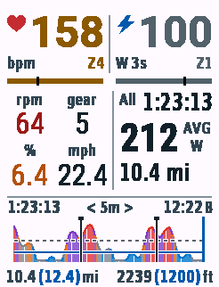

# FastRider · Garmin Edge 840 全屏数据页

Connect IQ / Monkey C 数据字段，按 Edge 840 原生 **246 × 322** 实现已确认的交互设计。只针对 Edge 840 构建；使用单字段全屏布局。



## 显示与点击

| 点击区域 | 循环切换 | 更新内容 |
| --- | --- | --- |
| 右上功率整块 | **3s ↔ 10s** | 平均功率数字、W 3s/10s、Zone 编号及颜色 |
| 右中统计整块 | **LAP x ↔ All** | 本圈/整次骑行的计时、平均功率、距离 mi |
| 功率图标题或曲线 | **5m → 20m → All** | 历史时间窗口与窗口内原生 Lap 起止标记 |

默认 **3s、All、5m**。点击只改变显示，不创建或清空 Lap。每次原生手动/自动分圈后，统计区自动显示最新 Lap，功率和图表范围的选择保持不变；仍可点击切回 All。活动重置恢复默认。

Garmin 从活动开始计时就进入第1圈，不需要另按 Lap。首次按 Lap 或触发自动圈会结束第1圈、开始第2圈。因此本页在第1圈先显示 All，首次分圈后自动显示 LAP 2；不会把首次按键误标成 LAP 1。心率区和底部距离/爬升文字不响应点击。

左中为 **rpm、后拨 gear、估算坡度 %、实时 mph**。底栏显示已骑距离 mi、累计爬升 ft；有效导航目的地提供剩余距离时，以蓝色括号显示。公开 API 没有剩余路线爬升，因此 live **不显示剩余爬升**，不使用目的地海拔或预导入 GPX 推算。demo 中的括号示例均为合成数据。

功率图区左上是活动已耗时（含暂停），中央为范围，右上是本地 12 小时时钟；按设计 **A = AM，B = PM**。白底，FTP 灰色虚线，Z2 上限蓝色实线，原生 Lap 边界黑色带顶帽竖线，当前位置蓝色竖线。纵轴固定为 **55%–150% FTP**，低于范围的有效功率压到底线，高于范围的功率裁到上缘；缺失/暂停断流不连接。All 显示整次活动中本字段采集到的历史，不会补造加载前的数据。

## 配色与数据口径

- 功率 Zone 上限为 FTP 的 55/75/90/105/120/150%。显示分组为 **Z1+Z3 灰、Z2 蓝、Z4 橘、Z5 紫、Z6+Z7 红**；实时功率与图中对应同组色系。图填充相当于白底 80% 不透明度，辅助线不透明。
- 两条实时 Zone 色条上的黑色竖线表示当前值在**当前编号 Zone**内的位置，左端为下限、右端为上限；跨区后回到新区左端，缺失数据时隐藏。功率使用正在显示的 3s/10s 平均值，不按合并配色组计算。心率使用原生首区下限和末区上限，无原生区间时首区从 0 起、末区到设置的最大心率；功率首区从 0 W 起。Z7（>150% FTP）没有有限上界，标记固定在右端。
- 心率独立使用五区：灰、蓝、绿、赭黄、红。优先采用原生骑行心率区间，否则用应用最大心率设置的 60/70/80/90%。
- 坡度 **>5% 橘，>10% 深红，>15% 深紫**；其余原色。坡度根据实测海拔/里程估计，不是 Garmin 原生 grade 字段。
- 踏频 **<70 深红、70–100 原色、>100 深紫**。零踏频有效；缺失显示 `--`。
- FTP 优先读 `UserProfile.getFunctionalThresholdPower(SPORT_CYCLING)`，无有效值时使用应用设置，默认 250 W。
- 3s/10s 为相应时间窗内有效采样均值，包含 0 W；缺失、暂停及超过 2.5 秒的断流清掉滑动窗口，不显示旧平均值。
- 圈时间/距离同步原生 Lap 回调。圈均功率是按有效采样时间加权的估计，**不是 Garmin 的原生圈均功率字段**；可能受丢包与原生零功率平均设置影响。All 均功率优先使用 Garmin 的 `Activity.Info.averagePower`。
- 圈时间和 All 统计时间使用 `timerTime`，不含暂停。图表与左上总耗时使用 `elapsedTime`，包含暂停。中途加载无法知道原生圈号、圈起点，显示 `LAP ?` 与 `--`；下一次原生 Lap 起获得完整圈内统计，圈号仍未知，不编造编号。
- 后拨 gear 读取 `rearDerailleurIndex`，需要电子变速传感器；不推测档位。

## 本地开发与运行

已配置 Java 17、Connect IQ SDK 9.3.0、Edge 840 官方设备包和 VS Code Garmin 扩展。只需安装 Edge 设备包，不需要下载全部设备。

```bash
./scripts/build.sh live     # bin/FastRider-live.prg：真实 Activity.Info
./scripts/run.sh demo       # 合成指标与历史，便于看布局和点击
./scripts/run.sh live       # 真实数据版本；模拟器 Activity Data → Start
./scripts/run.sh test       # Garmin VM 测试
python3 -m unittest discover -s tests -v
```

`source scripts/env.sh` 可加入 SDK 命令路径。`CIQ_SDK_PATH` 和 `CIQ_DEVELOPER_KEY` 可覆盖默认路径。签名密钥在 `.local/developer_key.der`，不提交 Git；`bin/` 同样排除。保留密钥用于后续更新。

模拟器选择 **Data Fields → Layout → 1 Field**。原生字段每秒重绘，点击模式立即更新模型，但画面可能等待下一次绘制；验收应在下一帧观察，避免把上一帧误认为未响应。

## 字体与历史内存

为保持小屏可读性，使用与矢量稿对应的七组精简位图字体：49/44/33/32/26/20/18 px。已提交生成后的字形资源，日常构建无需 Pillow。重新生成需 Pillow 和 SDK 自带字体：

```bash
python3 scripts/generate-fonts.py
```

统计区的 All / Lap 平均功率均使用加粗字体，四位数回退仍加粗。主数字超长时使用较小数值字体；窄格坡度/速度优先去掉小数，不压缩字形。时间过长则使用至少 18 px 的回退字体。全屏尺寸以 Dc 为准，非全屏布局显示 `1 field` 提示。

历史分为 3 秒/5 分钟、12 秒/20 分钟和自适应整次骑行三层，各最多 160 个桶。整次骑行层逐步合并桶，保留活动开始的数据及有效样本总和/数量；混合断流的桶不连接邻点。长时间压缩不保证分辨每个短暂断点。原生 Lap 标记最多保留 100 个，窗口外不绘制；高频碎片极端情况下，近期两层达到上限会丢弃最旧碎片。

## 安装到 Edge 840

1. `./scripts/build.sh live`。
2. USB 连接，将 `bin/FastRider-live.prg` 复制到设备 `GARMIN/APPS/`。
3. 在骑行活动中添加 Connect IQ → FastRider，设为单字段全屏。
4. 开始活动计时。live 不包含演示数据，不需要导入 GPX。

[验证记录](docs/validation.md) · [原生像素规则](docs/edge840-design-rules.md) · [批准的矢量稿](docs/design/summit-interactive.svg) · [All 模式截图](docs/summit-edge840-v02-all.png)

官方依据：[Activity.Info](https://developer.garmin.com/connect-iq/api-docs/Toybox/Activity/Info.html)、[DataField 回调](https://developer.garmin.com/connect-iq/api-docs/Toybox/WatchUi/DataField.html)、[DataField 点击委托](https://developer.garmin.com/connect-iq/articles/core-topics/Native_Controls.html)。
