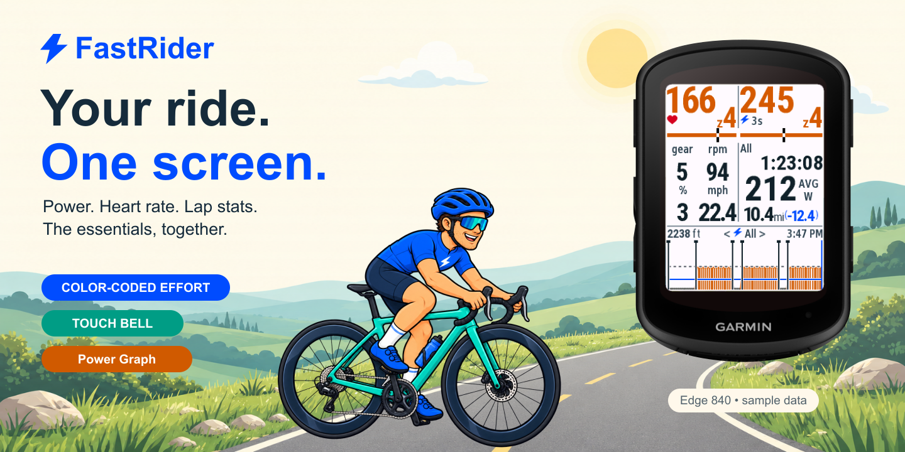
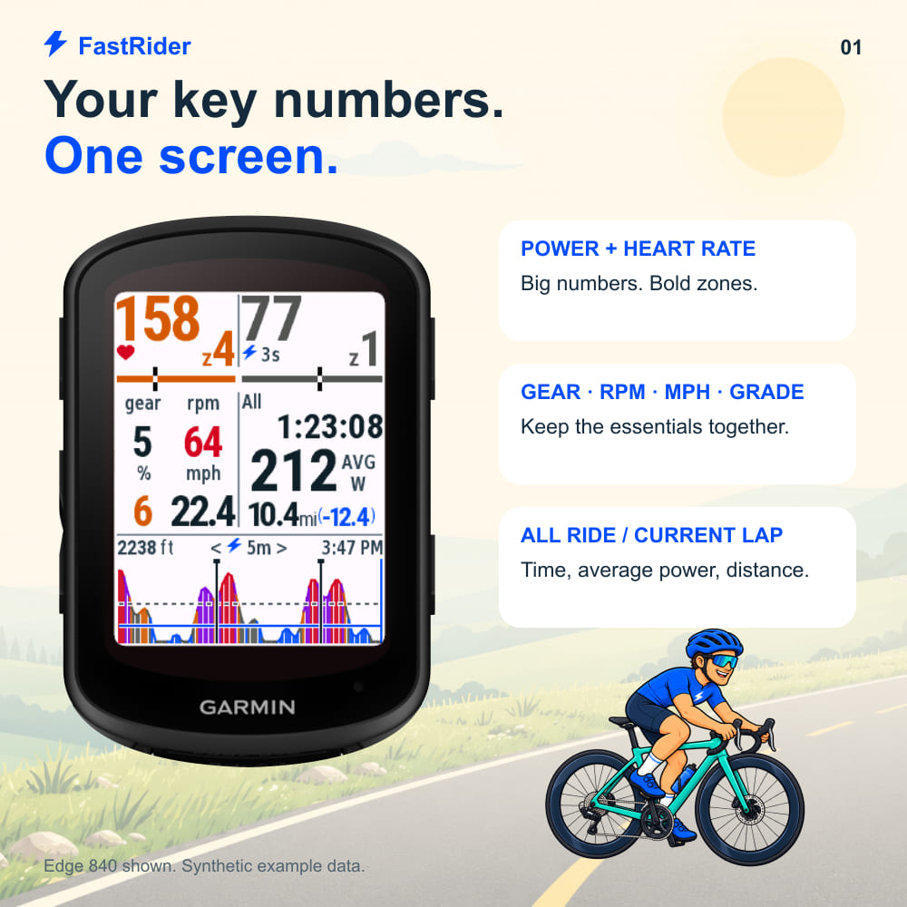
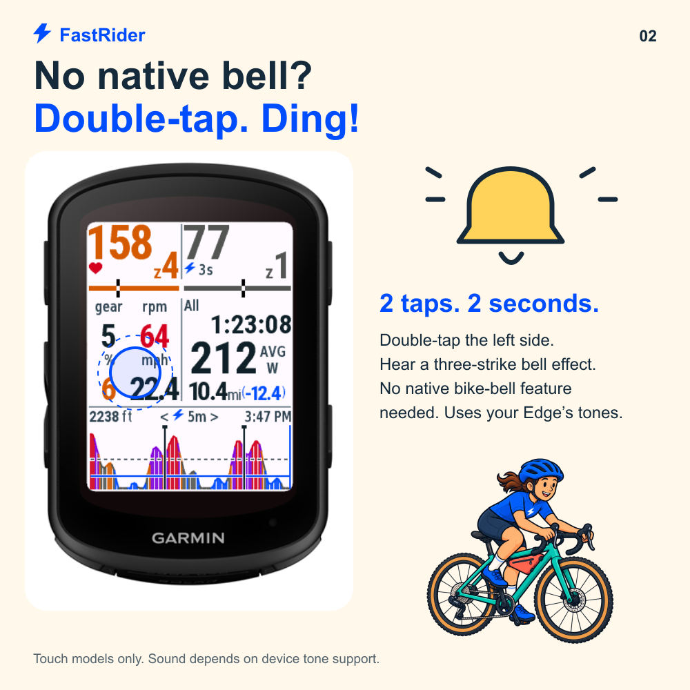
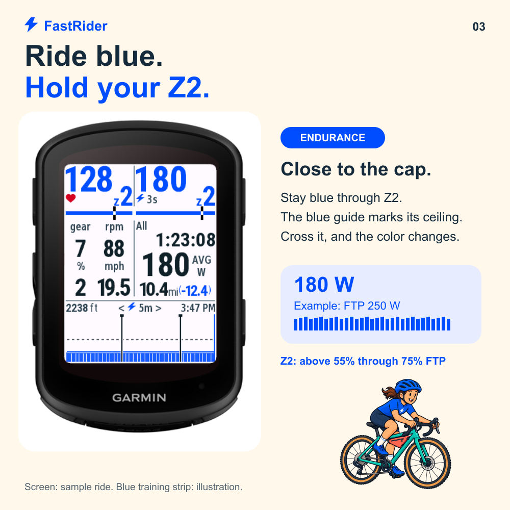
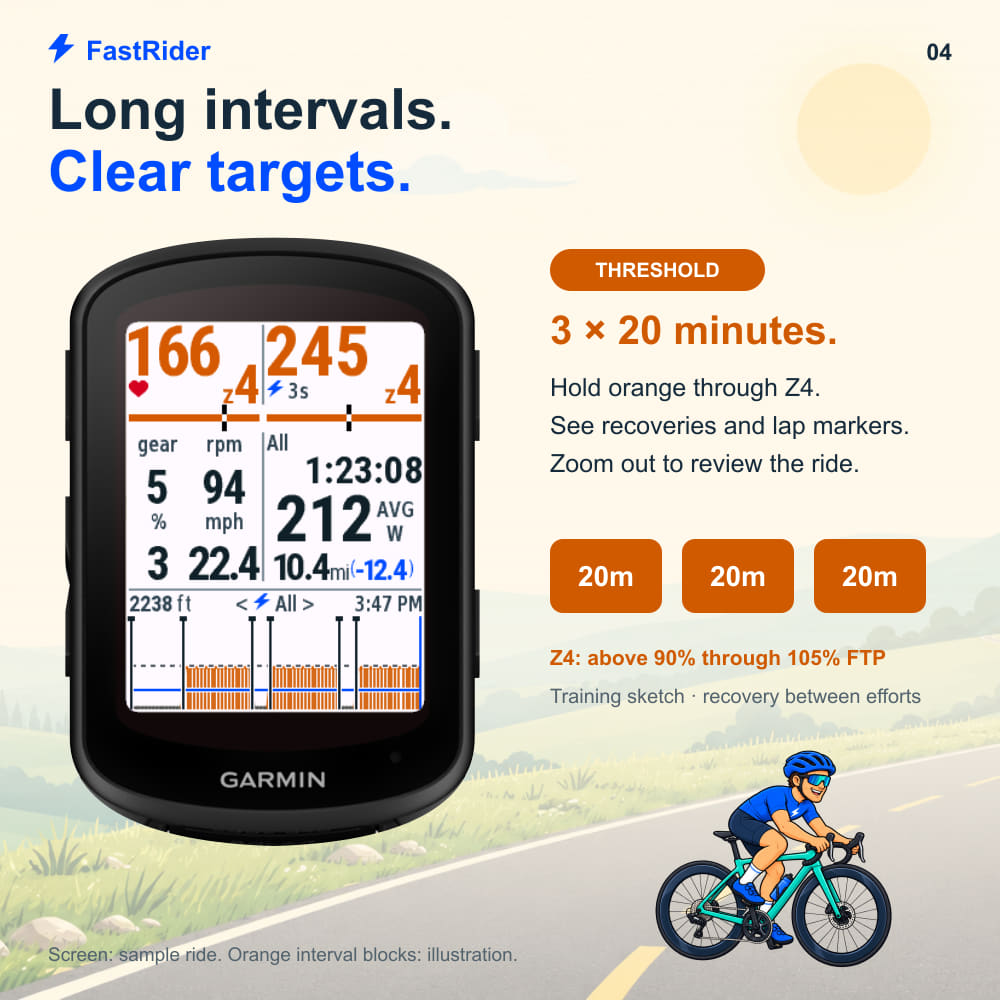
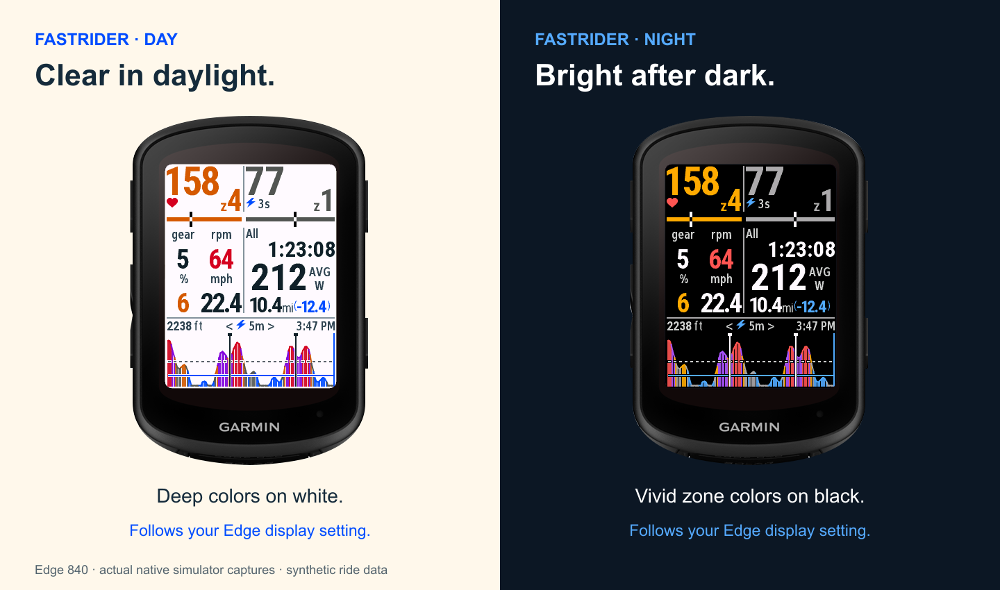
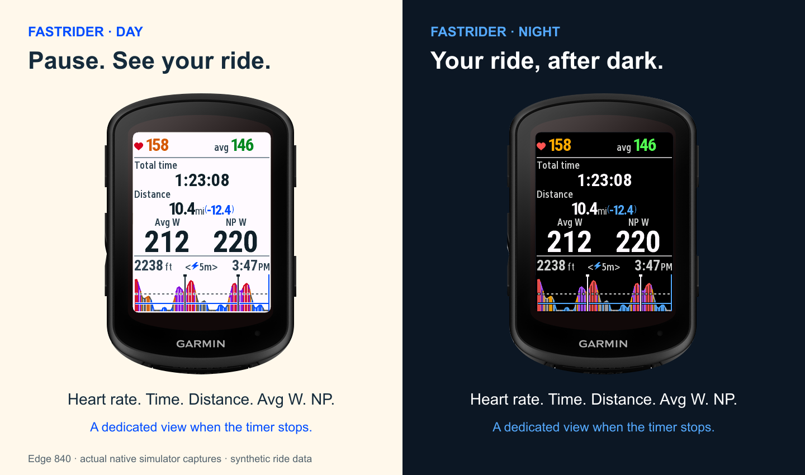
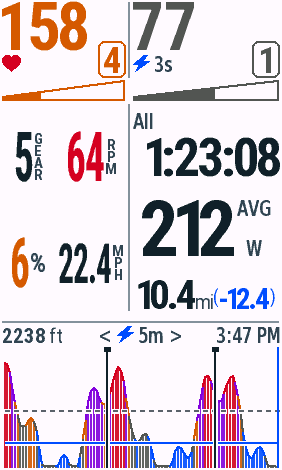
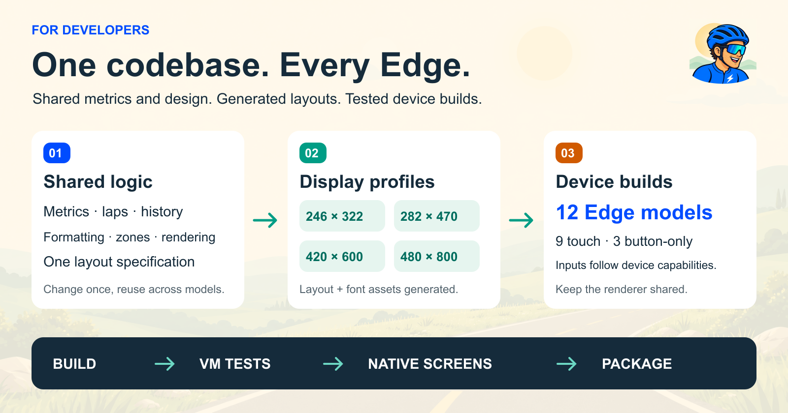

# FastRider

[English](README.md) · **简体中文**

[](#download)

**功率、心率、Lap 统计和骑行关键信息，一屏看清。**

免费、开源的 Connect IQ 全屏数据字段，支持 **12 款 Garmin Edge**。为骑行中的数字可读性、稳定 Z2 训练和长阈值间歇设计。

**[下载安装](#download)** · [安装步骤](#install) · [骑行操作](#controls) · [开发构建](#develop) · [参与贡献](#contribute)

## 给骑行者

- **关键信息放在一起。** 大号心率和功率，配合后拨档位、踏频、坡度、速度、Lap/All 统计与累计爬升。
- **用颜色判断强度。** 心率与功率显示 Zone 颜色和区间内位置；功率曲线与实时数字使用相同色系。
- **快速查看一个训练段。** 功率图包含 Z2 上限、FTP 辅助线和原生 Lap 标记，可查看最近5分钟、20分钟或整次骑行。
- **日夜清晰。** 跟随 Edge 自身的显示模式，夜间采用黑底亮字和更明亮的 Zone 配色。
- **双击响铃。** 支持触控的机型可播放两秒三击电子铃声，无需设备自带原生车铃功能。

<table>
<tr>
<td width="50%"><a href="store/campaign/v0.4.1/upload/04-screen-01-one-screen.jpg"></a></td>
<td width="50%"><a href="store/campaign/v0.4.1/upload/04-screen-02-touch-bell.jpg"></a></td>
</tr>
</table>

### 围绕训练强度设计的功率图

**Z2 保持蓝色，阈值保持橘色。** 功率图中，Z2 对应 FTP 的55%以上至75%，Z4 对应90%以上至105%。颜色变化便于发现强度偏移；辅助线与原生分圈标记帮助回看耐力训练，以及3 × 20分钟这样的阈值间歇。

<table>
<tr>
<td width="50%"><a href="store/campaign/v0.4.1/upload/04-screen-03-z2-training.jpg"></a></td>
<td width="50%"><a href="store/campaign/v0.4.1/upload/04-screen-04-threshold-intervals.jpg"></a></td>
</tr>
</table>

功率配色：**Z1/Z3 灰 · Z2 蓝 · Z4 橘 · Z5 紫 · Z6/Z7 红**。心率独立分区，踏频和坡度使用各自的提示颜色。这些是训练观察辅助，不执行训练计划。

*配图使用真实 Edge 840 外形、原生模拟器渲染界面和合成骑行数据。点击可查看完整尺寸。*

### 自动跟随日夜模式

FastRider 跟随 Edge 数据字段的系统背景色。将码表的显示模式设为**自动**，即可跟随 Garmin 自身的日夜切换；也可在码表上手动选择日间或夜间。下次重绘即应用配色，骑行历史和已选择的视图会继续保留。夜间颜色更明亮，功率与心率的 Zone 含义保持一致；字体抗锯齿、辅助线描边和 Zone 位置标记也会适应背景。

[](docs/validation/themes/v0.4.2/README.md)

<a id="download"></a>
### 暂停时，看整次骑行

手动停止计时或触发自动暂停后，页面自动切换为全程统计。顶部用较小数字显示当前心率和全程平均心率；中间显示开始后的总时间、总距离（导航剩余距离可用时附带显示）、全程平均功率与本地计算的 NP。底部保留功率图，爬升和时钟数字放大加粗，单位保持原字号。恢复计时后回到原骑行页面，保留已选择的视图。无触屏设备也会自动切换。

NP 需先积累30秒功率，真实零功率参与计算，暂停时间不参与。中途加载或数据缺失时显示 **NP est. W**，无数据时显示横线；本地结果可能与 Garmin 骑行结束后的 NP 不同。平均心率、平均功率优先使用 Garmin 原生全程统计。不显示 Moving。

[](docs/validation/summary/v0.4.3/README.md)

## 下载与支持设备

<!-- downloads:start -->
当前版本 **v0.4.3**，下载后即可安装，无需 SDK 或 Java。PRG 可直接复制到设备；ZIP 包含同一程序、安装说明和许可证。

| 设备 | 原生分辨率 | 操作 | PRG 直接下载 | ZIP 下载 |
| --- | --- | --- | --- | --- |
| Edge 530 | 246×322 | 默认视图 | [PRG](https://github.com/zhilichen/garmin-fast-rider/raw/refs/heads/main/releases/v0.4.3/edge530/FastRider.prg) | [ZIP](https://github.com/zhilichen/garmin-fast-rider/raw/refs/heads/main/releases/v0.4.3/edge530/FastRider-0.4.3-edge530.zip) |
| Edge 540 | 246×322 | 默认视图 | [PRG](https://github.com/zhilichen/garmin-fast-rider/raw/refs/heads/main/releases/v0.4.3/edge540/FastRider.prg) | [ZIP](https://github.com/zhilichen/garmin-fast-rider/raw/refs/heads/main/releases/v0.4.3/edge540/FastRider-0.4.3-edge540.zip) |
| Edge 550 | 420×600 | 默认视图 | [PRG](https://github.com/zhilichen/garmin-fast-rider/raw/refs/heads/main/releases/v0.4.3/edge550/FastRider.prg) | [ZIP](https://github.com/zhilichen/garmin-fast-rider/raw/refs/heads/main/releases/v0.4.3/edge550/FastRider-0.4.3-edge550.zip) |
| Edge 830 | 246×322 | 触控切换与车铃 | [PRG](https://github.com/zhilichen/garmin-fast-rider/raw/refs/heads/main/releases/v0.4.3/edge830/FastRider.prg) | [ZIP](https://github.com/zhilichen/garmin-fast-rider/raw/refs/heads/main/releases/v0.4.3/edge830/FastRider-0.4.3-edge830.zip) |
| Edge 840 | 246×322 | 触控切换与车铃 | [PRG](https://github.com/zhilichen/garmin-fast-rider/raw/refs/heads/main/releases/v0.4.3/edge840/FastRider.prg) | [ZIP](https://github.com/zhilichen/garmin-fast-rider/raw/refs/heads/main/releases/v0.4.3/edge840/FastRider-0.4.3-edge840.zip) |
| Edge 850 | 420×600 | 触控切换与车铃 | [PRG](https://github.com/zhilichen/garmin-fast-rider/raw/refs/heads/main/releases/v0.4.3/edge850/FastRider.prg) | [ZIP](https://github.com/zhilichen/garmin-fast-rider/raw/refs/heads/main/releases/v0.4.3/edge850/FastRider-0.4.3-edge850.zip) |
| Edge 1030 | 282×470 | 触控切换与车铃 | [PRG](https://github.com/zhilichen/garmin-fast-rider/raw/refs/heads/main/releases/v0.4.3/edge1030/FastRider.prg) | [ZIP](https://github.com/zhilichen/garmin-fast-rider/raw/refs/heads/main/releases/v0.4.3/edge1030/FastRider-0.4.3-edge1030.zip) |
| Edge 1030 Bontrager | 282×470 | 触控切换与车铃 | [PRG](https://github.com/zhilichen/garmin-fast-rider/raw/refs/heads/main/releases/v0.4.3/edge1030bontrager/FastRider.prg) | [ZIP](https://github.com/zhilichen/garmin-fast-rider/raw/refs/heads/main/releases/v0.4.3/edge1030bontrager/FastRider-0.4.3-edge1030bontrager.zip) |
| Edge 1030 Plus | 282×470 | 触控切换与车铃 | [PRG](https://github.com/zhilichen/garmin-fast-rider/raw/refs/heads/main/releases/v0.4.3/edge1030plus/FastRider.prg) | [ZIP](https://github.com/zhilichen/garmin-fast-rider/raw/refs/heads/main/releases/v0.4.3/edge1030plus/FastRider-0.4.3-edge1030plus.zip) |
| Edge 1040 | 282×470 | 触控切换与车铃 | [PRG](https://github.com/zhilichen/garmin-fast-rider/raw/refs/heads/main/releases/v0.4.3/edge1040/FastRider.prg) | [ZIP](https://github.com/zhilichen/garmin-fast-rider/raw/refs/heads/main/releases/v0.4.3/edge1040/FastRider-0.4.3-edge1040.zip) |
| Edge 1050 | 480×800 | 触控切换与车铃 | [PRG](https://github.com/zhilichen/garmin-fast-rider/raw/refs/heads/main/releases/v0.4.3/edge1050/FastRider.prg) | [ZIP](https://github.com/zhilichen/garmin-fast-rider/raw/refs/heads/main/releases/v0.4.3/edge1050/FastRider-0.4.3-edge1050.zip) |
| Edge 1060 | 480×800 | 触控切换与车铃 | [PRG](https://github.com/zhilichen/garmin-fast-rider/raw/refs/heads/main/releases/v0.4.3/edge1060/FastRider.prg) | [ZIP](https://github.com/zhilichen/garmin-fast-rider/raw/refs/heads/main/releases/v0.4.3/edge1060/FastRider-0.4.3-edge1060.zip) |

[全部型号 ZIP](https://github.com/zhilichen/garmin-fast-rider/raw/refs/heads/main/releases/v0.4.3/FastRider-0.4.3.zip) · [SHA256 校验值](releases/v0.4.3/SHA256SUMS) · [版本清单](releases/v0.4.3/manifest.json)
<!-- downloads:end -->

请选择与**设备型号完全对应**的文件。Solar 版本随 Garmin 对应设备包支持。所有型号都使用**单字段全屏**数据页面。

本页下载包可直接侧载，包含最新改动。[Connect IQ 页面](https://apps.garmin.com/apps/ba487f91-82ad-4baa-94f0-9002f86d6a53)显示商店可用情况；侧载版本与商店版本可能不同。

<a id="install"></a>
## 安装

1. 下载对应型号的 **PRG**；或下载 **ZIP**，解压后取型号文件夹中的 `FastRider.prg`。
2. 将 Edge 以 USB/电脑模式连接，复制到设备内部存储的 `GARMIN/APPS/`。macOS 上若没有显示为挂载磁盘，可通过支持 MTP 的文件传输工具访问。
3. 断开 USB，在骑行配置的数据页面选择 **Connect IQ → FastRider**，将布局设为**单字段**。

更新安装时，**沿用已安装文件的文件名**进行替换。早期安装可能叫 `SUMMIT.PRG`，此时将新文件改成同名再覆盖；首次安装使用 `FastRider.prg`。

先配对需要的数据源：功率、心率、踏频需要相应兼容传感器，后拨档位需要电子变速数据。没有数据时显示横线。当前单位是 **mi、mph、ft**。

<a id="controls"></a>
## 骑行操作

初始显示 **3s 功率 / All 整次骑行 / 5m 功率图**。

| 触屏区域 | 手势 | 结果 |
| --- | --- | --- |
| 右上功率 | 点击 | 3s ↔ 10s 平均 |
| 右侧统计 | 点击 | All 整次骑行 ↔ 当前 Lap |
| 功率图或时间范围标签 | 点击 | 5m → 20m → All |
| 左侧心率／实时信息 | 双击 | 两秒电子车铃 |

触屏机型在原生手动或自动分圈后显示最新一圈。Garmin 从活动开始便进入第1圈，第一次完成分圈后开始第2圈；FastRider 初始显示 **All**。

**Edge 530、540、550 始终使用固定的 3s / All / 5m 视图。** 不提供触控或电子车铃，功率图仍记录 Lap 边界。铃声音色和响度取决于设备提示音支持；使用的是设备提示音组合，并非 Garmin 原生车铃功能。

[点击切换图解](store/campaign/v0.4.1/upload/04-screen-06-tap-controls.jpg) · [配色图解](store/campaign/v0.4.1/upload/04-screen-05-color-coded.jpg)

### 数据是怎样计算的

| 数值 | 来源与行为 |
| --- | --- |
| FTP／心率区间 | 优先读取原生骑行资料；不可用时使用应用设置。FTP 缺省回退值250 W。 |
| 功率 | 有效0 W参与平均；缺失、暂停、断流时不会复用旧平均值。 |
| All／Lap 均功率 | All 优先使用 Garmin 整次活动均值；Lap 在本地估算，可能与 Garmin 圈统计不同。 |
| 时间 | 统计时长不含暂停；图表的 elapsed time 横轴包含暂停。 |
| 坡度／剩余距离 | 坡度由海拔和里程估算；Garmin 提供有效命名导航目的地时显示剩余距离。 |
| 历史 | 从字段开始运行时记录；无法恢复更早的骑行采样、未来路线海拔，以及中途加载前完整的圈状态。 |

### 查看你的机型

四个显示档覆盖不同分辨率与比例，大屏适当使用更大数字。**12款均有原生模拟器截图**，不代表所有型号均已进行实体设备验收。

<details>
<summary><strong>展开12款机型的原生截图画廊</strong></summary>

<!-- screenshots:start -->
原生日间模拟器截图。预览按同宽等比缩放，点击可查看原生像素；全部使用合成指标。

| Edge 530 | Edge 540 | Edge 550 |
| --- | --- | --- |
| <a href="docs/validation/screens/edge530.png"></a> | <a href="docs/validation/screens/edge540.png"></a> | <a href="docs/validation/screens/edge550.png"></a> |

| Edge 830 | Edge 840 | Edge 850 |
| --- | --- | --- |
| <a href="docs/validation/screens/edge830.png"></a> | <a href="docs/validation/screens/edge840.png"></a> | <a href="docs/validation/screens/edge850.png"></a> |

| Edge 1030 | Edge 1030 Bontrager | Edge 1030 Plus |
| --- | --- | --- |
| <a href="docs/validation/screens/edge1030.png"></a> | <a href="docs/validation/screens/edge1030bontrager.png"></a> | <a href="docs/validation/screens/edge1030plus.png"></a> |

| Edge 1040 | Edge 1050 | Edge 1060 |
| --- | --- | --- |
| <a href="docs/validation/screens/edge1040.png"></a> | <a href="docs/validation/screens/edge1050.png"></a> | <a href="docs/validation/screens/edge1060.png"></a> |

[更多状态、原图与验收记录](docs/screenshots.md)
<!-- screenshots:end -->

</details>

<a id="develop"></a>
## 给开发者



**数据信息和设计只在共享代码中修改。** 型号差异由设备目录描述，布局和字体按显示档生成；增加已有分辨率的设备不应再写一套渲染器。

### 本地开始

安装官方 [Connect IQ SDK Manager](https://developer.garmin.com/connect-iq/sdk/)、**JDK 17**、Bash 和 **Python 3.10+**。只下载需要的 Edge 设备包。仓库记录的构建与模拟器流程已在 macOS 验证。

```bash
git clone https://github.com/zhilichen/garmin-fast-rider.git
cd garmin-fast-rider

./scripts/check-env.sh edge840
./scripts/build.sh live edge840
./scripts/run.sh demo edge840
```

正式程序输出为 `bin/edge840/FastRider-live.prg`。`demo` 使用合成数据，`live` 读取真实活动信息。普通构建使用已提交的字体资源，不需要宣传图生成工具。

脚本读取 SDK Manager 当前选中的 SDK，也支持 `CIQ_SDK_PATH`、`CIQ_HOME`、`JAVA_HOME`。首次构建会在已忽略的 `.local/developer_key.der` 创建签名密钥；设置 `CIQ_DEVELOPER_KEY` 可指定已有密钥。同一应用更新需保留同一密钥；以独立应用发布 fork 时请使用自己的 App ID 和密钥。

### 到哪里修改

| 要修改的内容 | 共享源码 |
| --- | --- |
| 指标、功率窗口、圈统计、历史 | [source/model](source/model/) |
| 活动采样与绘制 | [FastRiderView.mc](source/app/FastRiderView.mc) |
| Zone 颜色与提示 | [DisplayRules.mc](source/ui/DisplayRules.mc) |
| 系统日夜主题与图表对比度 | [DisplayTheme.mc](source/ui/DisplayTheme.mc) |
| 默认视图、触控区域与分圈行为 | [InteractionState.mc](source/ui/InteractionState.mc) |
| 触控／车铃及无触屏入口 | [source/input](source/input/) |
| 坐标与间距 | [design/layout.json](design/layout.json) |
| 设备、显示档与能力 | [config/devices.json](config/devices.json) |

修改布局或设备目录后运行 `python3 scripts/generate-project.py`。新增字号或分辨率时，先运行 `python3 scripts/generate-fonts.py`，再重新生成项目。生成布局位于 `config/display/`，原生字库位于 `resources/fonts/`。

### 验证改动

```bash
# 无需SDK：源码、字体、下载包和已记录图像检查
python3 -m pip install -r requirements-dev.txt
python3 scripts/generate-project.py --check
python3 scripts/check-downloads.py
python3 scripts/check-generated-fonts.py
python3 -m unittest discover -s tests/python -v

# 单设备原生测试
./scripts/run.sh test edge840

# 全设备原生测试（macOS；先关闭其他CIQ模拟器）
source scripts/env.sh
python3 scripts/test-matrix.py
```

UI改动使用 `./scripts/build.sh snapshot edge840` 构建固定快照，在模拟器运行后导出**原生屏幕截图**，同时检查长数值、传感器缺失和受影响的显示档。840基准包含12种视图组合；若有意修改设计，应明确更新基准。

**v0.4.3**：新增暂停/停止全程统计页；12款机型441次原生测试执行通过；840日夜骑行页逐像素不变。[停止页验收](docs/validation/summary/v0.4.3/README.md)。

**v0.4.2**：12款机型共381次原生测试执行通过；日夜截图覆盖4种分辨率和无触屏530，5款日间截图及840切回日间均与v0.4.1逐像素一致。[日夜验收](docs/validation/themes/v0.4.2/README.md)。

**v0.4.1** 已记录的验收结果：12款机型共345次原生测试执行通过，840的12组参考状态逐像素保持一致。[验收证据](docs/validation.md) · [CI结果](https://github.com/zhilichen/garmin-fast-rider/actions)

### 打包

```bash
./scripts/build.sh live all
python3 scripts/package.py          # 本地dist/压缩包
python3 scripts/package.py --publish
python3 scripts/check-downloads.py
```

`--publish` 写入 `releases/` 下的版本文件，并更新**中英文README**中的下载表和画廊；不会自动推送 Git 或提交 Garmin。已发布版本目录不能被不同内容覆盖，应用变更需更新版本并重新验收。

[完整开发指南](docs/development.md) · [共享架构](docs/architecture.md) · [配图来源与再生成](docs/media/README.md)

<a id="contribute"></a>
## 参与贡献

[提交 issue](https://github.com/zhilichen/garmin-fast-rider/issues) 时请提供型号、固件与应用版本、数据页面布局及复现步骤。视觉问题请附截图，并说明是真机还是模拟器；尽量用合成数据复现，不提交签名密钥或私人活动文件。

PR应描述最终行为、受影响的显示档和验证结果。先阅读 [CONTRIBUTING.md](CONTRIBUTING.md)，保持数据、格式和绘制逻辑跨设备共享。

## 许可证与隐私

项目代码使用 [MIT](LICENSE)，字库遵循独立的[第三方许可证](THIRD_PARTY_NOTICES.md)。应用不向开发者收集或上传数据，见[隐私说明](PRIVACY.md)。

本项目与 Garmin 无隶属关系。Garmin 保留其设备设计与商标权；宣传插画和可编辑图解的来源见[配图说明](docs/media/README.md)。
