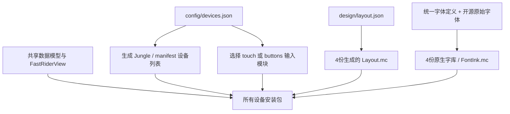

# 共享架构

所有设备共用同一套数据、格式、配色与绘制代码。设备分歧仅是显示分辨率、输入能力、启动图标尺寸，以及测试环境的旧/新 API 适配。

| 位置 | 职责 | 增加设备时是否通常要改 |
| --- | --- | --- |
| `source/model` | 功率窗口、历史、圈统计、坡度和格式 | 否 |
| `source/app/FastRiderView.mc` | 真实指标采样和共用渲染 | 否 |
| `source/ui/DisplayRules.mc` | Zone分组与状态阈值 | 否 |
| `source/ui/DisplayTheme.mc` | 跟随系统背景的日夜配色、标记与图表填充 | 否 |
| `source/ui/InteractionState.mc` | 默认状态、分圈行为和触控区域 | 否 |
| `source/input/touch` | 点击切换、双击车铃及触控应用入口 | 否 |
| `source/input/buttons` | 单视图入口；不引用触控或车铃实现 | 否 |
| `config/devices.json` | 设备→显示档、输入能力、旧API测试适配、图标尺寸 | 是 |
| `design/layout.json` | 唯一手写布局规范，以840为参考 | 新分辨率通常不需要 |
| `config/display/*` | 自动生成布局与字形边界 | 自动 |
| `resources/fonts/*` | 按分辨率共享的原生字体资源 | 自动 |

## 布局与字库

水平位置、基础字号、图标和线条随宽度缩放；字形按目标字号重新栅格化，不放大已有位图。顶部保留主数字贴顶和雷达安全区。中间区在顶部与图表之间重新分配纵向间距；底部功率图约占整页四分之一。

246×322档完整保留v0.3.15的原始资源、坐标与间距。282×470、420×600、480×800档从同一规范生成，无逐机型渲染分支。字体最小回退档向下取整，以保留长里程的小数精度。原生字体裁剪底部统一保留1 px余量，避免截断末行。

282×470、420×600、480×800通过显示档的`emphasize_numbers`启用大数字候选。gear、踏频、坡度、速度、统计时间、均功率和里程分别选择能容纳完整数值的最大候选；原有字号保留为回退，因此长时间、三位踏频和长里程不会因加入大字号而失去精度。统计区数字用实际字形边界紧凑排版，三个数值行在可用高度内等距分布；布局生成器直接读取字体度量，避免不同比例下发生上下覆盖。

字体ID中的数字是840基准名称，并不代表其他分辨率的实际字号；真实尺寸与ink边界由该档的`FontInk.mc`给出。基础16个角色保留原序，大屏额外追加4个候选。资源加载及各数据的候选列表都由字体生成器统一产出，渲染器不维护逐机型的字体表。

## 改信息与加设备

修改数据来源或显示内容时，更新共用的采样/渲染函数。需要新位置时只在`design/layout.json`增加或调整锚点，重新生成即可同步全部显示档。Zone分组和提示阈值只改`DisplayRules.mc`；日夜色板统一在`DisplayTheme.mc`维护。

增加同分辨率设备时，只需在设备目录加入目标及能力，确认设备包中的启动图标尺寸，运行生成器并构建、测试。新分辨率在`profiles`增加宽高后，先生成字库，再生成布局；仍需原生截图验收字体回退、雷达留白及触控边界。

旧版GPX导入、路线投影和已走海拔图原型已经移除。历史设计和验收资料集中于`docs/archive/v0.3`，不参与应用构建。

## 日夜模式

每次`onUpdate`先读取原生`DataField.getBackgroundColor()`，再由每个视图持有的`DisplayTheme`选择日间或夜间色板。时间/日出日落由码表的原生自动模式决定，不另设时刻或位置权限。API从1.2起可用，全部支持机型均可使用。

同一主题实例只在系统背景改变时更新属性，不重新创建数据模型、历史或输入状态。BMFont仍使用原始灰度覆盖资源，所有文字绘制使用当前背景作为抗锯齿底色。图表填充按90%不透明度混合到当前背景；FTP/Z2/Lap辅助线用同一背景描边，Zone位置标记在黑底下改用白色端点与黑色切口。

夜间色彩锚点采用旧款MIP屏的64色RGB立方体，降低颜色量化导致色系混淆的风险。[原生截图与测试记录](validation/themes/v0.4.2/README.md)。
