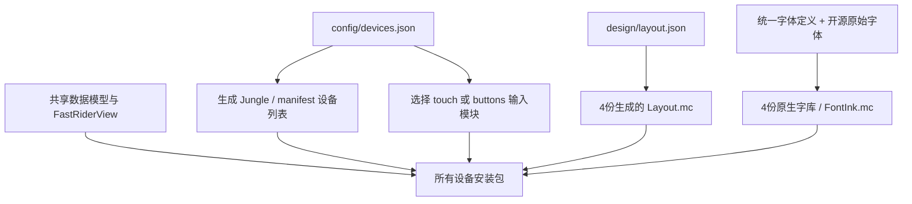

# 共享架构

所有设备共用同一套数据、格式、配色与绘制代码。设备分歧仅是显示分辨率、输入能力、启动图标尺寸，以及测试环境的旧/新 API 适配。

| 位置 | 职责 | 增加设备时是否通常要改 |
| --- | --- | --- |
| `source/model` | 功率窗口、历史、圈统计、坡度和格式 | 否 |
| `source/app/FastRiderView.mc` | 真实指标采样和共用渲染 | 否 |
| `source/ui/DisplayRules.mc` | Zone分组与状态阈值 | 否 |
| `source/ui/DisplayTheme.mc` | 跟随系统背景的日夜配色、标记与图表填充 | 否 |
| `source/ui/InteractionState.mc` | 默认状态、分圈行为和触控区域 | 否 |
| `source/input/touch` | 点击切换、双击车铃及触控应用入口 | 否 |
| `source/input/buttons` | 单视图入口；不引用触控或车铃实现 | 否 |
| `config/devices.json` | 设备→显示档、输入能力、旧API测试适配、图标尺寸 | 是 |
| `design/layout.json` | 唯一手写布局规范，以840为参考 | 新分辨率通常不需要 |
| `config/display/*` | 自动生成布局与字形边界 | 自动 |
| `resources/fonts/*` | 按分辨率共享的原生字体资源 | 自动 |

## 布局与字库

水平位置、基础字号、图标和线条随宽度缩放；字形按目标字号重新栅格化，不放大已有位图。顶部保留主数字贴顶和雷达安全区。中间区在顶部与图表之间重新分配纵向间距；底部功率图约占整页四分之一。

v0.4.1多设备适配时，246×322档完整保留v0.3.15的原始资源、坐标与间距；后续v0.4.4和v0.4.5分别有意更新Zone和实时信息区域。282×470、420×600、480×800档从同一规范生成，无逐机型渲染分支。字体最小回退档向下取整，以保留长里程的小数精度。原生字体裁剪底部统一保留1 px余量，避免截断末行。

282×470、420×600、480×800通过显示档的`emphasize_numbers`启用大数字候选。gear、踏频、坡度、速度、统计时间、均功率和里程分别选择能容纳完整数值的最大候选；原有字号保留为回退，因此长时间、三位踏频和长里程不会因加入大字号而失去精度。统计区数字用实际字形边界紧凑排版，三个数值行在可用高度内等距分布；布局生成器直接读取字体度量，避免不同比例下发生上下覆盖。

字体ID中的数字是840基准名称，并不代表其他分辨率的实际字号；真实尺寸与ink边界由该档的`FontInk.mc`给出。基础16个角色保留原序，大屏额外追加4个候选；v0.4.5在其后统一附加6个实时信息角色。资源加载及各数据的候选列表都由字体生成器统一产出，渲染器不维护逐机型的字体表。

## 改信息与加设备

修改数据来源或显示内容时，更新共用的采样/渲染函数。需要新位置时只在`design/layout.json`增加或调整锚点，重新生成即可同步全部显示档。Zone分组和提示阈值只改`DisplayRules.mc`；日夜色板统一在`DisplayTheme.mc`维护。

增加同分辨率设备时，只需在设备目录加入目标及能力，确认设备包中的启动图标尺寸，运行生成器并构建、测试。新分辨率在`profiles`增加宽高后，先生成字库，再生成布局；仍需原生截图验收字体回退、雷达留白及触控边界。

旧版GPX导入、路线投影和已走海拔图原型已经移除。历史设计和验收资料集中于`docs/archive/v0.3`，不参与应用构建。

## 日夜模式

每次`onUpdate`先读取原生`DataField.getBackgroundColor()`，再由每个视图持有的`DisplayTheme`选择日间或夜间色板。时间/日出日落由码表的原生自动模式决定，不另设时刻或位置权限。API从1.2起可用，全部支持机型均可使用。

同一主题实例只在系统背景改变时更新属性，不重新创建数据模型、历史或输入状态。BMFont仍使用原始灰度覆盖资源，所有文字绘制使用当前背景作为抗锯齿底色。图表填充按90%不透明度混合到当前背景；FTP/Z2/Lap辅助线用同一背景描边，Zone位置标记在黑底下改用白色端点与黑色切口。

夜间色彩锚点采用旧款MIP屏的64色RGB立方体，降低颜色量化导致色系混淆的风险。[原生截图与测试记录](validation/themes/v0.4.2/README.md)。

## 计时状态与停止页

`RideScreenState` 集中映射原生 TIMER_STATE：ON 使用原骑行布局，PAUSED（Auto Pause）和 STOPPED 使用 `SummaryRenderer`，OFF 保留原待骑行布局。原生计时回调立即切换，`compute()` 再用 Activity.Info 同步状态。恢复时不重置触控选择、Lap 或历史。停止页不响应隐藏的功率/圈统计触控，图表范围与车铃仍按设备能力工作。

停止页独立锚点位于 `design/layout.json` 的 summary 字段，由同一生成器生成四份 `SummaryLayout.mc`。原有 Layout 与字库资源保持不变。平均心率读 `averageHeartRate`，平均功率优先读 `averagePower`，总时间用 `elapsedTime`。不实现 Moving。

`NormalizedPower` 在活动计时时间轴上将观测功率采样保持到1秒，以完整30秒滑动平均的四次方均值开四次根。只保留30个值和累计和；缺失值不会当作零，暂停不会注入零。计时回退/重置清空；中途加载、丢样或无法连接的时间段标记 estimated。NP 不从 Garmin 原生统计读取，也不跨应用卸载恢复；不足30秒显示横线，记录不全显示 NP est. W。全程均心率与均功率仍优先用原生数据，避免中途加载丢失全程均值。

## Zone 徽标与梯形进度

骑行页的分区编号使用原有数字字库，移除Z前缀，外围为同色圆角空心框。框线由内外圆角填充图形构成，确保边框严格落在安全区域内；无需新增字体或逐设备位图。梯形左端4px、右端18px左右（840参考），实心宽度取原zoneFraction乘整条宽度并钳制0–100%，右侧保留当前主题背景。轮廓和实心采用相同Zone颜色，图形继续启用平台提供的抗锯齿。缺失值显示横线，梯形只画轮廓；无有限上限的功率Z7沿用原有满格逻辑。分区计算不因外观变更而改变。全部锚点在layout.json统一维护。

## 实时信息竖排标注

`LiveMetrics`共享绘制左中2×2信息：档位/踏频、坡度/速度。数值和右侧标注作为整体居中，间隔为840参考1px；GEAR/RPM/MPH逐字母竖排，%单独居中并稍大。以实际数值字形宽度、标注最大字符宽度选择最大可容纳字体，保留完整小数。新字体由原矢量字源4×栅格化到更窄的粗体目标；只附加新角色，不改变原有字体角色索引或旧字形文件，其他区域继续使用原字库。灰阶覆盖保留，仅清除低于3%的重采样晕边，避免不可见晕边虚增字宽。

## 停止页八项全程统计

v0.4.6停止页顶部显示elapsedTime和当前时钟，右上仍预留系统雷达区域。中间复用左窄右宽的列宽，左列为实时/平均心率、平均功率和NP，右列为距离、爬升、averageCadence和averageSpeed。新增平均值直接读取Activity.Info，排除timerTime为0时的原生历史残留，保留实际0值。图表分隔线由独立SummaryLayout下移，图表标题只保留范围。停止页图表触控、反馈边框和左侧双击铃声区域跟随新分隔线。caption使用附加的SummaryLabel14字体，原有字体索引与字形保持。

v0.4.7骑行页使用共享RideStatistics绘制同排All/Lap与时间；只对H:MM:SS的秒部分选择约2/3字高的附加字体，普通MM:SS保持同字号。Zone框与数字放大，功率Zone位于雷达保留区左侧；三位功率使用同字高窄体，长值逐级回退。区间条与middle起点上移。骑行距离独立使用RIDE_DISTANCE_PAIRS选择更大字形，停止页仍使用原DISTANCE_PAIRS，避免修改其像素。原有字库索引保留，新角色仅追加。

字体按需加载并保留最多16个最近使用的字库，旧图形运行环境为8个。Meta18实际加载逐字形像素/度量完全相同的39字符子集，原始完整资源保留。旧Zone/Z字库仍保留资源与索引以便历史像素校验，但正常页面不会加载。跨骑行/停止页与数值宽度变化时淘汰最久未用字库，避免530/830把所有回退字号同时驻留。

三档历史上限均为128点，普通5m/20m窗口约101桶，保持3s/12s采样间隔。All仍使用既有自适应合并，较早触发压缩。此限制与字库缓存共同保证旧运行环境的容量边界；不是新增逐机型绘制分支。
