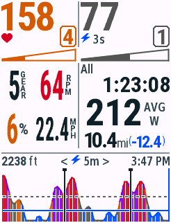
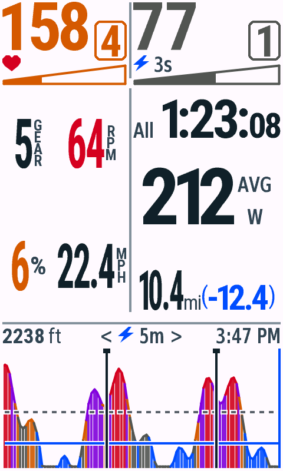

v0.4.12停止页：简写标题和数字后小字单位，见[最新原生画面](validation/summary/v0.4.12/README.md)。骑行布局保持v0.4.11。

v0.4.11截图版本：全部12款机型的骑行日间图库均为本次原生导出。四种分辨率的骑行/停止日夜模式也已完成画面核对，见下方验收记录。

最新字号与停止页验收：[v0.4.11](validation/readability/v0.4.11/README.md)。

v0.4.10骑行里程改为主值+右侧上下信息列。[最新原生图与验收](validation/distance/v0.4.10/README.md)。

v0.4.9功率框右对齐，三/四位数字自适应。[最新原生图与验收](validation/power/v0.4.9/README.md)。

v0.4.8停止页精简标签、放大数字与加宽右栏。[最新图与验收](validation/summary/v0.4.8/README.md)。

v0.4.7骑行页更新Zone框、同排计时与更大距离。[最新原生图与验收](validation/riding/v0.4.7/README.md)。

v0.4.6更新停止页为八项全程统计，骑行页保持v0.4.5画面。[停止页新图与验收](validation/summary/v0.4.6/README.md)。

当前默认图已更新为v0.4.5的大数字实时信息与右侧竖排标注。[本轮原图与验收](validation/live-cells/v0.4.5/README.md)。

当前默认画面已更新为v0.4.4的Zone数字框与梯形进度。[本轮原图与验收](validation/zones/v0.4.4/README.md)。以下历史边界图保留其原有版本。

# 原生模拟器画面

新增：[v0.4.2 日间／夜间对照与验收](validation/themes/v0.4.2/README.md)。以下保留 v0.4.1 日间基准。

v0.4.1，单字段全屏。截图由各目标的 Connect IQ 模拟器直接导出，使用固定合成指标和15:47时钟；图片尺寸就是数据字段的原生像素尺寸。

| 246×322：Edge 840 | 282×470：Edge 1040 |
| --- | --- |
|  |  |

| 420×600：Edge 850 | 480×800：Edge 1060 |
| --- | --- |
|  |  |

放大预览时可能产生浏览器插值，请打开原图检查像素边界。

| 型号 | 原图 | 输入 |
| --- | --- | --- |
| Edge 530 | [246×322](validation/screens/edge530.png) | 默认视图 |
| Edge 540 | [246×322](validation/screens/edge540.png) | 默认视图 |
| Edge 550 | [420×600](validation/screens/edge550.png) | 默认视图 |
| Edge 830 | [246×322](validation/screens/edge830.png) | 触屏 |
| Edge 840 | [246×322](validation/screens/edge840.png) | 触屏 |
| Edge 850 | [420×600](validation/screens/edge850.png) | 触屏 |
| Edge 1030 | [282×470](validation/screens/edge1030.png) | 触屏 |
| Edge 1030 Bontrager | [282×470](validation/screens/edge1030bontrager.png) | 触屏 |
| Edge 1030 Plus | [282×470](validation/screens/edge1030plus.png) | 触屏 |
| Edge 1040 | [282×470](validation/screens/edge1040.png) | 触屏 |
| Edge 1050 | [480×800](validation/screens/edge1050.png) | 触屏 |
| Edge 1060 | [480×800](validation/screens/edge1060.png) | 触屏 |

触屏切换后的10s / Lap / 20m：[850](validation/screens/edge850-interaction.png)、[1060](validation/screens/edge1060-interaction.png)。真实数据入口的缺失传感器画面：[530](validation/screens/edge530-live.png)、[1060](validation/screens/edge1060-live.png)。

[验收方法与结果](validation.md) · [840的12种逐像素对照](validation/edge840/pixel-regression.json)

## 长数字与缺失传感器

以下同样由原生模拟器导出，使用独立的合成测试输入。长数字保留`300.5mi(-200.5)`完整精度；缺失值显示`--`。

| 分辨率 | 长数字 | 缺失数据 |
| --- | --- | --- |
| 282×470 | [1040](validation/screens/edge1040-stress.png) | [1040](validation/screens/edge1040-missing.png) |
| 420×600 | [850](validation/screens/edge850-stress.png) | [850](validation/screens/edge850-missing.png) |
| 480×800 | [1060](validation/screens/edge1060-stress.png) | [1060](validation/screens/edge1060-missing.png) |

大屏数字字号与间距说明：[v0.4.1验收记录](validation/layout-v041/README.md)。对照v0.4.0原图：[1040](validation/layout-v041/before/edge1040.png)、[850](validation/layout-v041/before/edge850.png)、[1060](validation/layout-v041/before/edge1060.png)。
