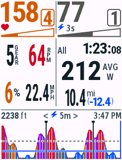
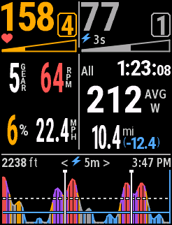
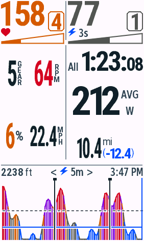
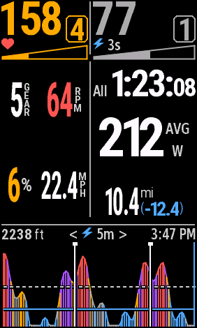
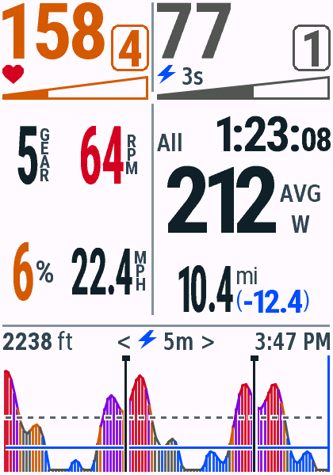
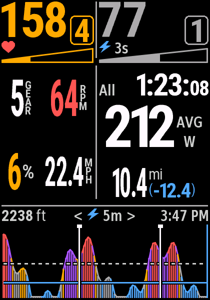
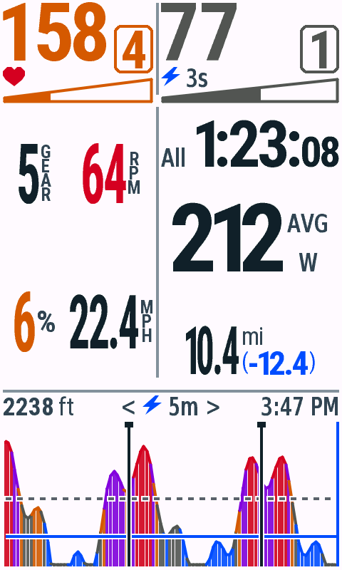
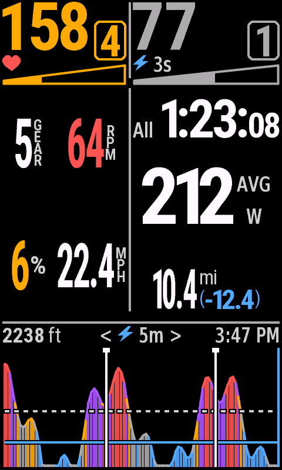

# v0.4.10 骑行里程上下叠排

2026-10-29，macOS / JDK17 / Connect IQ SDK9.3.0。单字段全屏，合成数据。本轮不自动提交商店，USB安装情况见包记录。

12款机型558次原生测试和11项Python检查全部通过，36次live/test/snapshot构建无警告。停止页与骑行其他区域的8项日夜像素检查均为0差异。

## 格式

骑行页距离改为两列：左侧大字已骑行距离，右侧mi在上、蓝色剩余里程在下。mi与括号共用同一左边线，保留常规括号与加粗数字；没有导航剩余距离时只显示mi。All保持一位小数，Lap保持两位小数。

840常用10.4主数字仍为34px字高，右侧mi为原15px字高、剩余数字17px。两行按实际字形高度留出至少1个840参考像素间隔。整个块在原距离区域内居中，底部不超过统计区。长读数按同一套字形候选自适应缩小，完整小数优先；无新增字库位图。

新增共用RideDistance模块，所有型号使用同一宽高拟合与坐标计算。里程文本精度、剩余里程格式及极端值回退通过FastRiderView.distanceText共用。停止页继续使用原布局，不启用此叠排。

## 验证

[原生测试矩阵](vm-matrix.json) · [Python检查](python-tests.txt) · [字库一致性](font-checks.txt) · [像素回归](pixel-checks.json) · [字段首帧内存](field-memory.json) · [分发校验](packages.json)。

新增测试覆盖10.4 / 300.5 / 888.8的完整小数与剩余里程、无导航、Lap0.42和缺失距离；检查两列宽度、上下行间隔、字号、主值居中和区域边界，并在日夜绘制。既有功率3/4位、触控、铃声、NP与统计状态检查保留。

| 设备 | 日间 | 夜间 |
| --- | --- | --- |
| Edge530 |  |  |
| Edge840 |  |  |
| Edge1040 |  |  |
| Edge850 |  |  |
| Edge1050 |  |  |

边界：[长里程](edge840-stress-day.png) · [无剩余里程](edge840-missing-day.png) · [Lap](edge840-lap-day.png) · [满容量旧设备](edge1030-capacity-day.png)。原图由File → Save Screen Capture导出，未反色或重绘。

原生字段默认首帧为76,368–116,416 bytes；1030满容量四位功率场景首帧125,024 / 127,424 bytes。该记录不代表真实长骑行峰值。

满容量场景完成原生Start → Pause → Resume，见[暂停](edge1030-capacity-paused-day.png)和[恢复](edge1030-capacity-resumed-day.png)。
