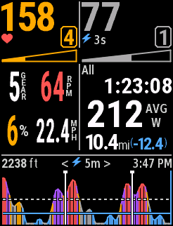
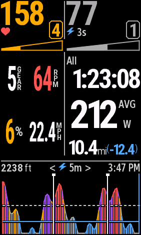
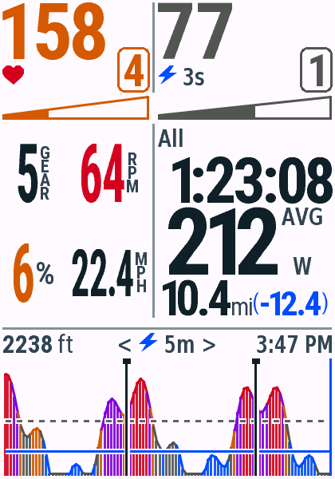
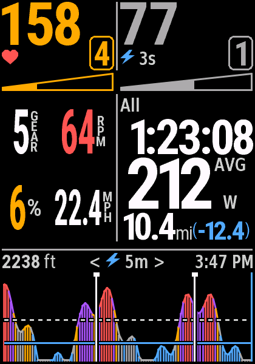
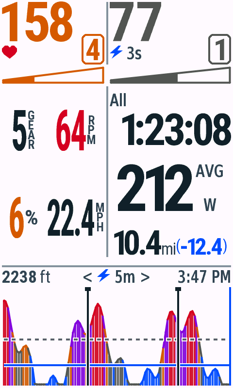
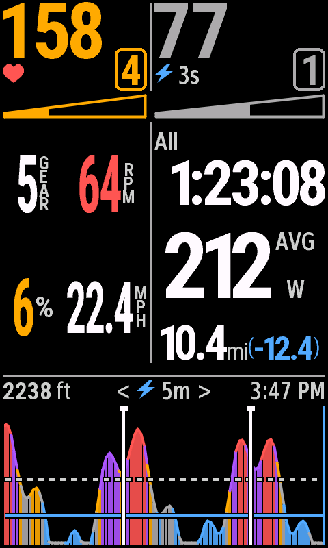

# v0.4.5 大数字实时信息验收

日期：2026-10-29。macOS、JDK17、Connect IQ SDK9.3.0。单字段全屏布局；全部为合成数据。本轮USB列表未检测到Edge，未安装或验收真机，也未上传Connect IQ Store。

## 设计与字形

骑行页左中保持2×2：左上gear、右上rpm、左下grade、右下mph。数字放大加粗；GEAR、RPM、MPH紧靠数字右侧逐字母竖排，%单独居中并略大。两列宽度840参考46/60px，保留2px列间隙；数字和标注作为整体居中，间隔为1px。速度保持一位小数，坡度保持整数，现有颜色规则不变。

为使带小数读数也能变大，增加四个更高、更窄的粗体数字候选，以及13号竖排字母、22号百分号角色（840参考）。从原开源矢量字源4×渲染灰阶覆盖，保留抗锯齿；仅清除低于3%的重采样晕边，避免不可见晕边虚增间距。数值按实际可见宽度选择最大字体；极端离群读数可再回退现有字体以保持完整，而非截断小数。

四种显示档的8组常见读数（5、12、64、120、6、-16、22.4、100.5）全部比v0.4.4相同内容的实际数字墨迹更高，并完整容纳数字+标注。[32组字形增长记录](glyph-growth.json)。840典型档位/踏频/坡度数字由28px墨迹高度增至43px，22.4mph由28增至34px，100.5mph由21增至30px；-16%仍需较窄候选，由28增至30px。

保留全部原有字体角色索引、PNG/FNT文件与字形像素，仅在资源声明和FontInk尾部附加6个角色（840共22、大屏共26）。原始资源声明另外保存在历史fixture并检查原SHA256，当前声明必须保持原有条目和顺序。顶部、统计区与图表仍使用原有字库。

## 构建与测试

12款设备的live、test、默认snapshot全部顺序构建成功，无警告。本轮初次并行构建曾触发SDK内部错误，最终使用互不重叠的顺序构建；字体生成完成后再编译。

原生VM通过489次测试执行：按钮机型每款34项、触屏机型每款43项。[逐设备汇总](vm-matrix.json)。新增检查八组常见读数的真实墨迹高度增长、数字+标注宽度、99档/999rpm/±60%/999.9mph离群值回退、边距，以及日夜正常/长读数/缺失值绘制。已有Zone、触控、铃声、Lap、暂停恢复、NP和标题安全区测试继续通过。

Python8项、生成文件和四档字库像素/度量检查通过。字号检查比较真实字形高度，不仅比较名义字号。[实际字段首帧堆记录](field-memory.json)为75,904–105,984 bytes，低于当时报告的127,424上限；这是合成历史首帧，不代表长骑行峰值。

## 像素回归

840日间、夜间都仅在左中四格区域改变4591像素；允许区域外为0像素差异。顶部主数字与Zone、右侧Lap/All、底部标题及功率图完全不变。停止页日夜均为0像素差异。[像素、尺寸与SHA256](pixel-checks.json)。

## 原生截图

全部由File → Save Screen Capture导出，未重绘、反色或修饰。12款机型日间默认图均保存在本目录并同步到README画廊。以下5款覆盖4种分辨率和按钮机型：

| 设备 | 日间 | 夜间 |
| --- | --- | --- |
| Edge 530 |  |  |
| Edge 840 |  |  |
| Edge 1040 |  |  |
| Edge 850 |  |  |
| Edge 1050 |  |  |

边界：[三位踏频、负坡度与100.5mph日间](edge840-stress-day.png) · [夜间](edge840-stress-night.png) · [缺失值日间](edge840-missing-day.png) · [夜间](edge840-missing-night.png)。

停止页：[日间](edge840-stopped-day.png) · [夜间](edge840-stopped-night.png)。

## 分发

v0.4.5包含12个正式PRG、12个单机型ZIP和完整ZIP；内容、CRC、许可证与SHA256均通过检查，历史版本保留。[包清单](packages.json)。本地IQ覆盖12款机型、17个地区编号，位于dist/connect-iq/v0.4.5，本轮没有提交商店。
