# v0.4.9 功率 Zone 右对齐与数字自适应

2026-10-29，macOS / JDK17 / Connect IQ SDK9.3.0。单字段全屏，合成数据。该版本不由此流程提交商店，USB安装情况见包记录。

## 规则

功率Zone框右边缘与Layout.RIGHT_EDGE对齐，不再为雷达留出框的位置。840框右边缘由216移到244，外侧保留2px边距，数字区从69增至99px。功率数字与框至少保留1个840参考像素间隔；其他分辨率按同一设计比例缩放。

三位数字保持原Primary58大字形。四位数字优先使用较小的完整粗体Average54：840字高由42缩至39px，1234、4444、8888和9999均完整可见。更长异常值继续缩小，且不会选取比三位字形更高的窄体。字号变化保持底部基线一致。心率、单位图标、Zone区间条、中部统计、功率图及停止页布局不变。

所有型号复用同一拟合逻辑，没有新增字库位图或逐设备绘制代码。停止页时钟仍沿用原有位置。

## 验证

[原生测试矩阵](vm-matrix.json) · [Python检查](python-tests.txt) · [像素回归](pixel-checks.json) · [字段首帧内存](field-memory.json) · [分发与签名](packages.json)。

原生测试覆盖典型和宽字形三位/四位功率、65535长值回退、框与数字不重叠、底部基线、左右边距、日夜绘制及原有触控/车铃/统计逻辑。Python根据真实FNT进宽和字形墨迹，验证任意三位组合的宽度上界以及任意四位组合的最大宽度，四种分辨率均成立。

12款机型546次原生测试、11项Python检查全部通过，36次live/test/snapshot构建无警告。停止页、心率区及中下部区日夜共6项像素检查均为0差异。1030满容量4444显示完成原生Start → Pause → Resume，首帧123,032 / 127,424 bytes。

## 840 原生示例

| 三位大字 | 四位缩小 | 最宽四位组合 |
| --- | --- | --- |
| 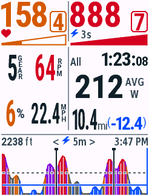 | 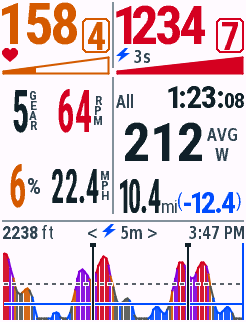 | 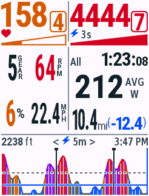 |
| 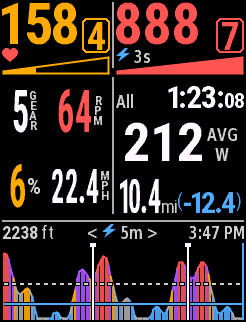 | 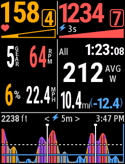 | 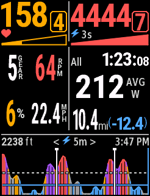 |

四种屏幕比例的日夜原图：

| 设备 | 日间 | 夜间 |
| --- | --- | --- |
| Edge530 |  |  |
| Edge840 | 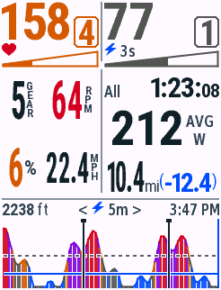 | 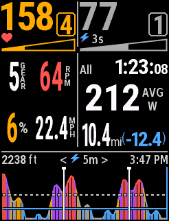 |
| Edge1040 | 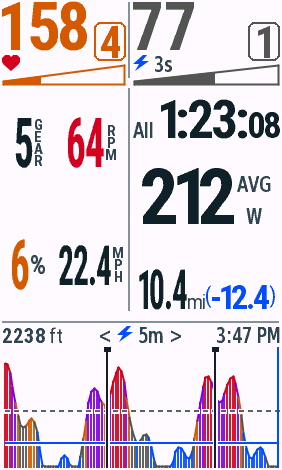 | 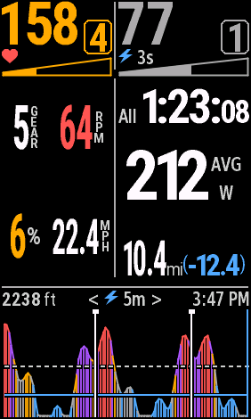 |
| Edge850 | 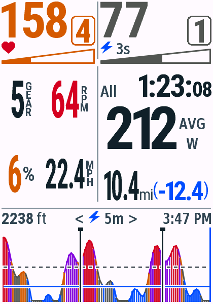 | 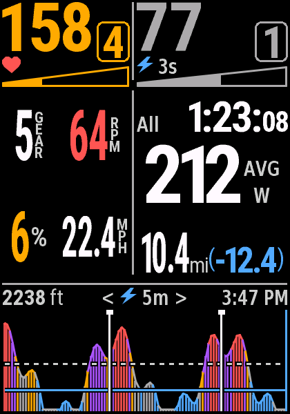 |
| Edge1050 |  | 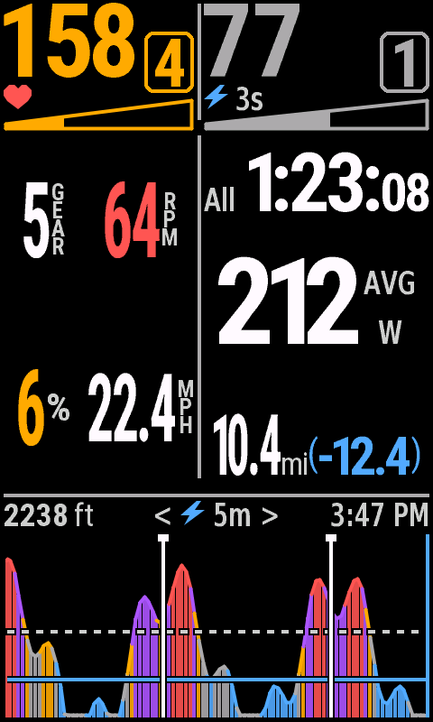 |

其他型号原生图同步到README机型图库。另有[1030满容量四位功率](edge1030-capacity-day.png)，三档历史各128点、100个Lap标记。容量快照不代表真实长骑行峰值。

满容量[暂停](edge1030-capacity-paused-day.png)与[恢复](edge1030-capacity-resumed-day.png)原图。
