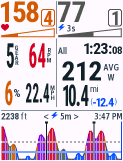
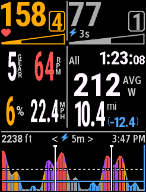
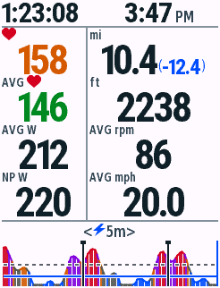
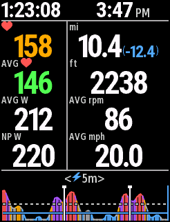

# v0.4.11 更大的骑行数字与紧凑停止页

2026-10-29，Connect IQ SDK9.3.0 / macOS / JDK17。全屏单字段，全部截图使用合成数据。本轮准备更新包，不自动提交商店。

## 布局

840骑行页：左中2×2仍为档位/踏频、坡度/速度，数字字形放大，保留侧边竖排标签；常见档位、踏频与坡度字高50px，22.4mph字高39px，较长读数按宽度回退。右中10.4主里程字高由34px提高至43px；mi与剩余里程保持右侧上下两行，完整小数优先。

停止页：顶部仅保留总时长和当前时间，AM/PM不变；首条横线由840的y48上移至y29，释放19px。中间竖线由x102移至x96，右栏宽度由138px增加至144px；四行从上至下重新均匀排列，常用统计数字实际字高由28px提高到33px，长距离仍保留小数和蓝色剩余里程。功率图位置与高度保持原值。

所有型号仍共用一套UI、几何生成器和字形选择规则。替换四个已有窄数字字库，并增加一个停止页专用宽体数字字库；原840核心字库保留。旧API设备的字库缓存由8个收紧到6个，避免较大字形在满历史、满Lap场景下的内存不足；历史容量和采样规则未变。

## 画面

| 模式 | 日间 | 夜间 |
| --- | --- | --- |
| 840骑行 |  |  |
| 840停止 |  |  |

边界：[长读数](edge840-stress-day.png) · [停止长读数](edge840-stopped-stress-day.png) · [缺失数据](edge840-missing-day.png) · [停止缺失](edge840-stopped-missing-day.png) · [Lap](edge840-lap-day.png) · [四位功率](edge840-power-four-day.png)。

本次已导出530、540、550与840的新截图。其余型号的最终交互画面导出尚未完成，主图库暂保留v0.4.10原图；12款设备、4种显示比例均已通过v0.4.11原生VM绘制与字号边界测试。

旧设备满容量：[骑行](edge1030-capacity-day.png) · [原生暂停](edge1030-capacity-paused-day.png) · [恢复](edge1030-capacity-resumed-day.png)。截图经File → Save Screen Capture原生导出，未重绘屏幕。

## 验证记录

最终12款机型共558次原生VM测试、11项Python检查通过；live/test/snapshot共36次最终构建无警告。840顶部、时间/平均功率与功率图的日夜像素比较共6项，均为0差异。

[原生VM矩阵](vm-matrix.json) · [Python检查](python-tests.txt) · [字库检查](font-checks.txt) · [字形尺寸](ink-sizes.json) · [未修改区域像素检查](pixel-checks.json) · [字段内存](field-memory.json) · [分发校验](packages.json)。

测试覆盖长里程与剩余里程、小数速度、负坡度、3/4位功率、缺失数据、日夜绘制、Lap/All、原生暂停与恢复。首帧字段内存记录不代表真实长骑行峰值。

最终旧设备缓存为6个。1030满容量四位功率场景首帧123,424 / 127,424 bytes，并完成Start → Pause → Resume；正式包采用相同缓存上限。
