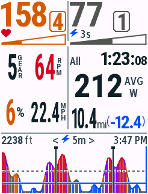
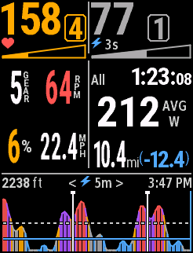
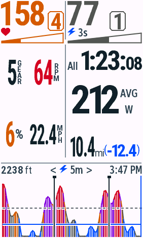
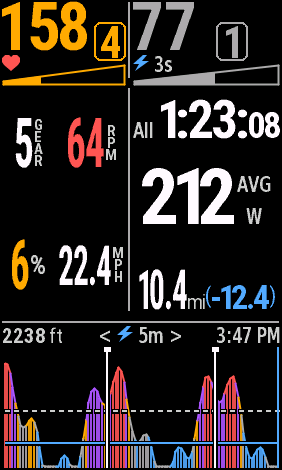
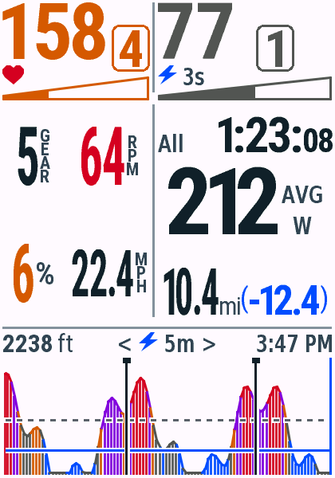
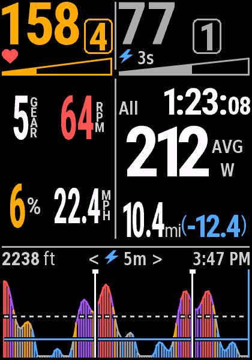
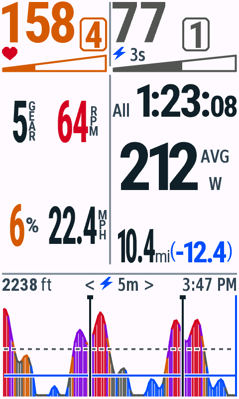
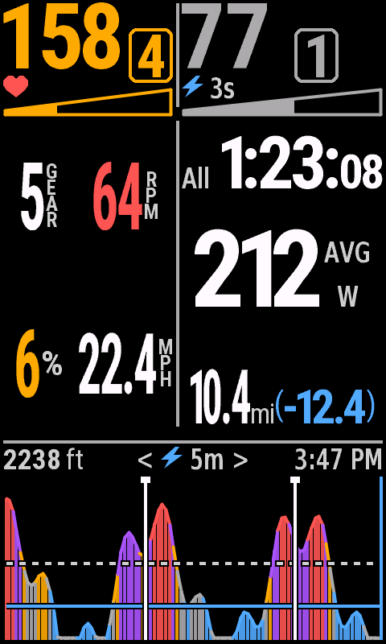

# v0.4.7 骑行页 Zone、时间与距离排版

日期：2026-10-29；Connect IQ SDK 9.3.0、JDK 17、macOS。单字段全屏，全部使用合成数据。未提交 Connect IQ Store。本轮未检测到 USB Garmin，未进行真机安装或实测。

## 变化

840 参考坐标中，Zone 框宽由 24 增至 28px，数字字高由 22 增至 28px；框底由 68 上移至 53px，数字底部仍略低于实时数字。功率框右侧止于 x216，为系统雷达保留右上 x218–245 区域。三位功率采用同字高窄体，四位及更长数据按可用宽度回退。

梯形区间条从 y70–88 上移至 y56–74，中部起点从 y91 提至 y77。实时信息首行同步上移。All / Lap 与计时同处一行；H:MM:SS 中的秒数使用约主数字 2/3 的字高，MM:SS 保留统一字号。平均功率向上移动，距离使用腾出的高度：840 常用 10.4mi(-12.4) 主数字字高从22增至34px，剩余数字从17增至21px，括号继续常规字重、蓝色显示。长距离保留完整小数优先，宽度不足时逐级缩小。

所有设备复用同一 RideStatistics 与生成的 Layout/FontInk；停止页继续使用原 SummaryLayout 与距离字号规则。

## 构建、原生测试与资源

12款机型546次原生测试、10项Python检查全部通过，live/test/snapshot共36次构建无警告。[逐机型原生 VM 测试](vm-matrix.json)；[Python 检查](python-tests.txt)；[字库像素及度量检查](font-checks.txt)。新增同排计时与小时秒数、长 Lap 编号、Zone/实时读数宽度、距离放大，以及按需字库缓存测试。既有手势切换、车铃时长、统计状态、NP、采样与日夜主题测试继续保留。

字体按需加载并缓存最近16个角色（旧图形运行环境8个），保留原资源与索引；旧 Zone/Z 和未用回退字库不会自动占用字段堆。1030 的压力快照填满三档128个历史点与100个Lap标记，实际字段模式下首帧使用121,784 / 127,424 bytes，随后实际执行Start → Pause → Resume，均正常绘制。此场景为确定性容量测试，不等于真实长骑行的峰值保证。[压力骑行](edge1030-capacity128-day.png) · [暂停](edge1030-capacity128-paused-day.png) · [恢复](edge1030-capacity128-resumed-day.png)。

[字段首帧内存](field-memory.json)与[像素检查](pixel-checks.json)单独记录，不使用测试 VM 的大堆推断字段模式余量。840 停止页日夜与 v0.4.6 均为0像素差异；骑行页功率图区域同样为0像素差异，数据区按本轮要求变化。

三档历史上限由160改为128点，普通5m/20m窗口约101桶，3s/12s采样间隔不变；All保留自适应压缩并稍早合并。标签Meta18加载39字符子集，完整字库仍保留，逐字符度量与像素保持一致。

## 原生画面

File → Save Screen Capture 导出，未重绘或反色。四种屏幕比例均检查日夜模式；12款日间原图同时更新至 README 机型图库。

| 设备 | 日间 | 夜间 |
| --- | --- | --- |
| Edge 530 |  |  |
| Edge 840 |  |  |
| Edge 1040 |  |  |
| Edge 850 |  |  |
| Edge 1050 |  |  |

840 边界：[300.5mi(-200.5)、四位功率与100.5mph](edge840-stress-day.png) · [传感器缺失](edge840-missing-day.png) · [Lap分钟格式](edge840-lap-day.png) · [Lap小时格式](edge840-lap-hours-day.png) · [100小时](edge840-hours-stress-day.png) · [10s功率](edge840-ten-second-day.png)。

## 分发

12个正式 PRG、12个逐机型 ZIP 与完整 ZIP 由同一生产代码打包，旧版文件保留。[打包与签名 IQ 校验](packages.json)。商店候选版为0.4.7；已提交的0.4.1商店记录保留，不自动提交此版本。
