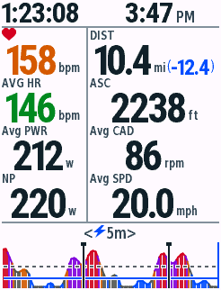
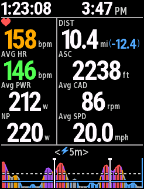
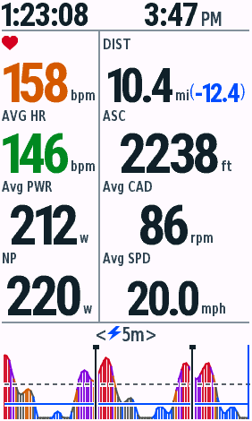
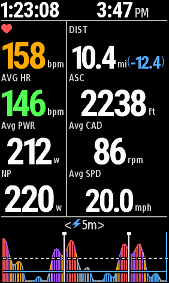
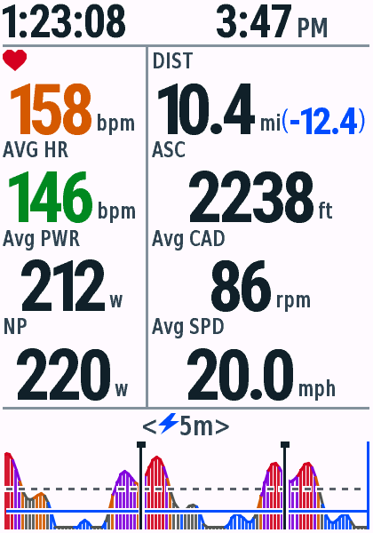
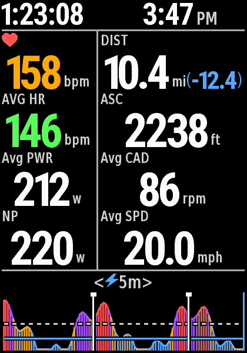
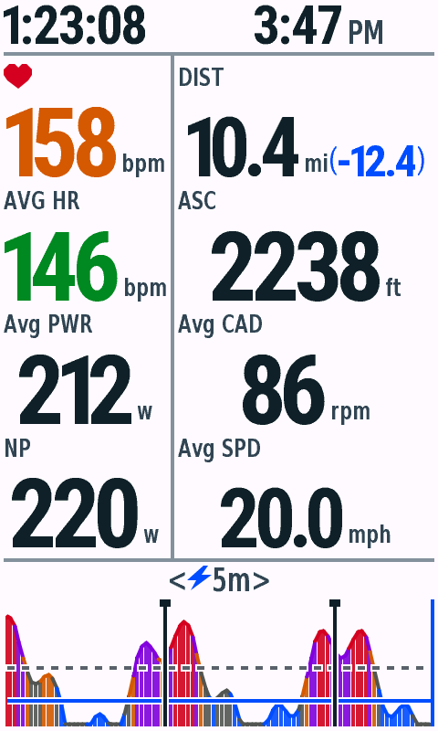
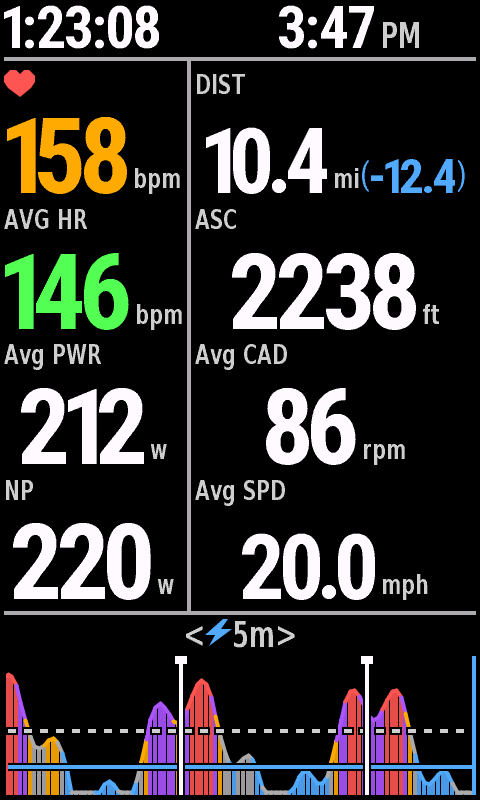

# v0.4.12 停止页简写标题与数字后单位

2026-10-29，macOS / JDK17 / Connect IQ SDK9.3.0。全屏单字段，合成数据；本轮不自动提交商店。

## 内容

| 左栏标题 | 数字后单位 | 右栏标题 | 数字后单位 |
| --- | --- | --- | --- |
| 当前心率心形图标 | bpm | DIST | mi |
| AVG HR | bpm | ASC | ft |
| Avg PWR | w | Avg CAD | rpm |
| NP（缺段时NP est） | w | Avg SPD | mph |

平均心率的心形图标已移除，当前心率仍保留图标。所有单位采用同一小字角色，按字形下沿与主数字对齐，避免bpm/rpm/mph的下伸笔画盖住下一行。数字和单位作为整体在各自栏内居中；现有常用数字字号保留，长读数按完整宽度自动选择字形。

距离使用10.4 mi(-12.4)，mi紧跟已骑行距离，蓝色括号为剩余里程；没有可用导航剩余距离时省略括号。优先保留完整小数，包括300.5 mi(-200.5)与888.8 mi(-999.9)。单位占用的宽度会先从距离拟合预算中扣除。

上下分隔线、统计顺序、原生全程平均数据、NP计算、分区配色、日夜主题、触控与铃声保持原样。未增加字库或调整缓存上限；全部型号共用SummaryRenderer。

## 原生画面

| 设备 | 停止日间 | 停止夜间 |
| --- | --- | --- |
| 840 |  |  |
| 1040 |  |  |
| 850 |  |  |
| 1050 |  |  |

[840长数值](edge840-stopped-stress-day.png) · [缺失数据](edge840-stopped-missing-day.png) · [1030满容量暂停](edge1030-capacity-paused-day.png) · [恢复骑行](edge1030-capacity-resumed-day.png)。图片通过模拟器File → Save Screen Capture导出，未重绘。

## 验证

12款机型共558次原生测试、11项Python检查通过；36次live/test/snapshot构建无警告。840骑行整页和停止页头部/功率图的日夜回归共6项，均为0像素差异。

[原生VM矩阵](vm-matrix.json) · [Python检查](python-tests.txt) · [像素回归](pixel-checks.json) · [长距离宽度检查](distance-widths.json) · [字段内存](field-memory.json) · [分发校验](packages.json)。

新增宽度和字形边界检查覆盖数字连单位、缺失值、五位功率/爬升、三位踏频、带小数的高速度及长距离/剩余里程。日夜绘制与原生暂停/恢复沿用完整测试矩阵。

1030满容量三路历史（各128点）与100个Lap标记、4444W场景完成原生Start → Pause → Resume。首帧字段内存记录不代表真实长骑行峰值。
