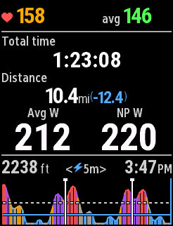
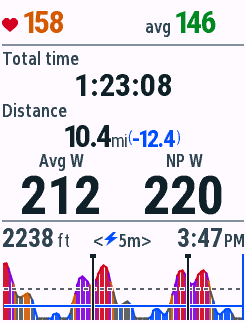
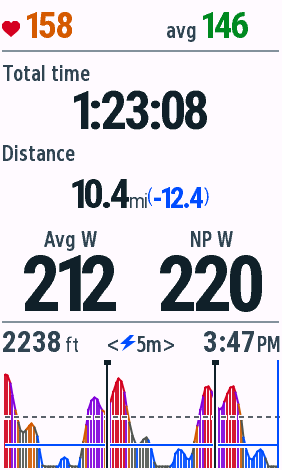
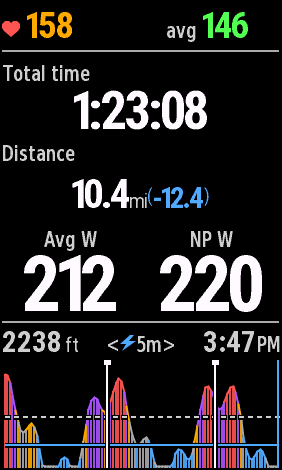
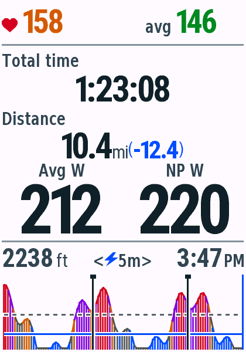
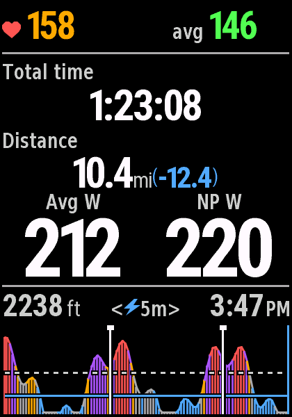
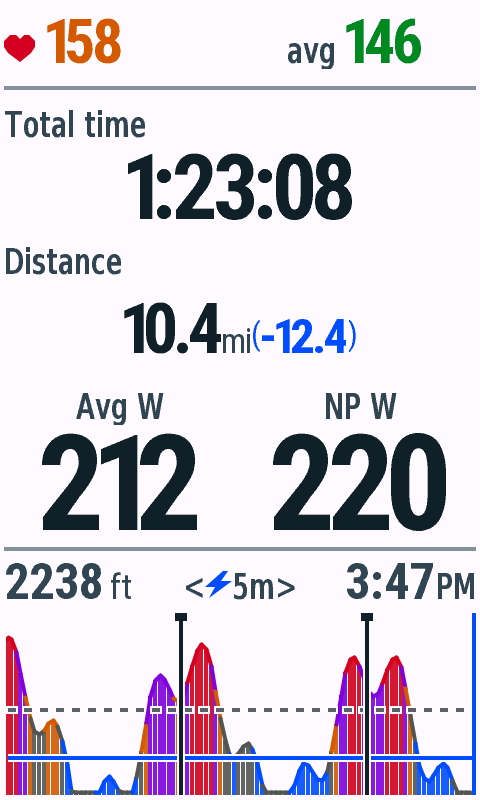
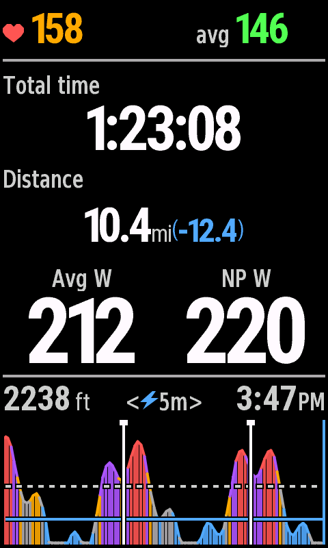

# v0.4.3 暂停/停止页验收

日期：2026-10-29。macOS、JDK17、Connect IQ SDK9.3.0；单字段全屏布局，全部使用合成数据。本轮未安装或验收实体设备，USB列表未检测到Edge。

## 状态与内容

原生 Activity.TIMER_STATE_ON 仍显示原骑行页；PAUSED（自动暂停）和 STOPPED（手动停止计时）显示全程统计。OFF保留待骑行页面。原生回调立即重绘，后续compute以Activity.Info同步状态。恢复保留功率/统计/图表选择、Lap和历史。停止页隐藏的功率与圈统计触控不会改变选择，图表切换与车铃按设备能力保留。

停止页顶部显示较小的当前心率与全程均心率，没有Zone编号或Zone条；中间显示总经过时间、总距离及可用的导航剩余距离、平均功率和NP。不显示Moving。平均心率与平均功率优先取Garmin原生全程统计；总时间用elapsedTime。图表标题的爬升和时钟数字放大加粗，ft与AM/PM保持原字号；标题区增高，范围居中压缩空格，保证99999ft、12:59AM及20m能同时容纳。

NP本地按1秒活动计时时间重采样、30秒滑动均值、四次方均值开四次根计算。真实零功率参与，缺失值不会当作零，暂停不补零。中途加载或丢样标记NP est. W；不足完整30秒显示横线。本地NP不保证与Garmin骑行结束后的结果相同，也不跨应用卸载恢复历史。[Garmin Activity.Info](https://developer.garmin.com/connect-iq/api-docs/Toybox/Activity/Info.html) · [NP公式](https://www.trainingpeaks.com/coach-blog/normalized-power-how-coaches-use/)

## 构建与测试

12款live、test程序均编译成功，无警告。原生VM通过441次测试执行：按钮机型每款30项，触屏机型每款39项。[逐机型记录](vm-matrix.json)。新增覆盖30秒预热、恒定功率、零功率间歇的独立数值参考、500ms采样、重复时间戳、断流、暂停恢复、重置、状态切换、全部主题下正常/长数字/缺失数据渲染，以及四种分辨率的标题区左右安全间距。

Python8项检查、生成文件检查、四档字体像素与度量检查均通过。840字体资源完全不变。

## 原生模拟器操作

使用Simulation → Activity Data → Start → Pause → Resume → Stop，验证实际原生回调改变页面。导出[暂停](edge840-native-paused-night.png)、[恢复](edge840-native-resumed-night.png)、[停止](edge840-native-stopped-night.png)画面。恢复后的统计和布局保持，滚动功率窗口依照既有行为重新积累，因此Zone位置标记有44像素差异；断点导致图表1像素差异。这些变化不属于布局漂移。

普通骑行页与v0.4.2日间、夜间截图相比均为0个不同像素。[骑行日间](edge840-riding-day.png) · [骑行夜间](edge840-riding-night.png) · [像素与SHA256记录](pixel-checks.json)。

## 四种显示档

File → Save Screen Capture原生导出，无截图反色或美化。共享SummaryRenderer和生成的SummaryLayout，不维护逐机型分支。

| 型号 | 日间 | 夜间 |
| --- | --- | --- |
| Edge 530 |  |  |
| Edge 840 |  |  |
| Edge 1040 |  |  |
| Edge 850 |  |  |
| Edge 1050 |  |  |

[840长数字](edge840-stress-day.png)保留300.5mi(-200.5)，并验证99999ft、12:59AM、四位平均功率。缺失心率、距离、功率、NP的占位和绘制由所有机型的原生渲染测试覆盖。

## 分发

[包清单、大小与SHA256](packages.json)。v0.4.3包含12个正式PRG、12个单机型ZIP和完整ZIP，所有CRC、内容和SHA256通过check-downloads校验；旧版本保持不变。签名IQ在本地dist/connect-iq/v0.4.3准备，本轮未上传或提交Garmin审核。
