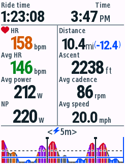
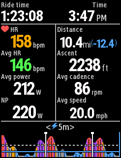
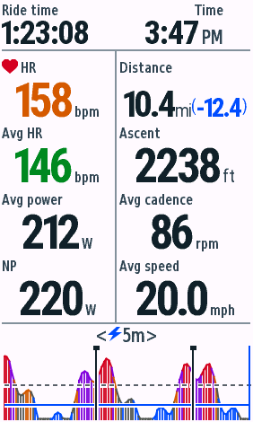
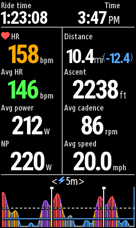
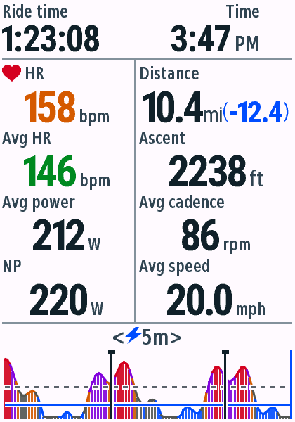
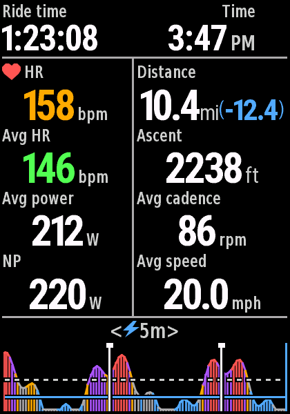
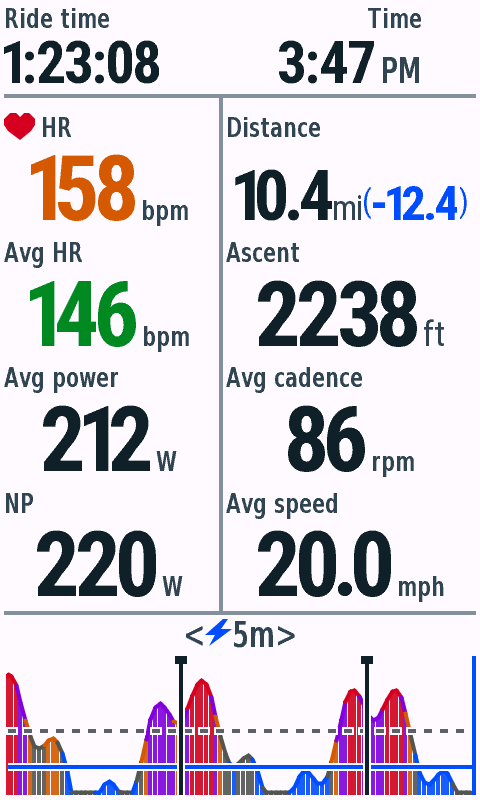
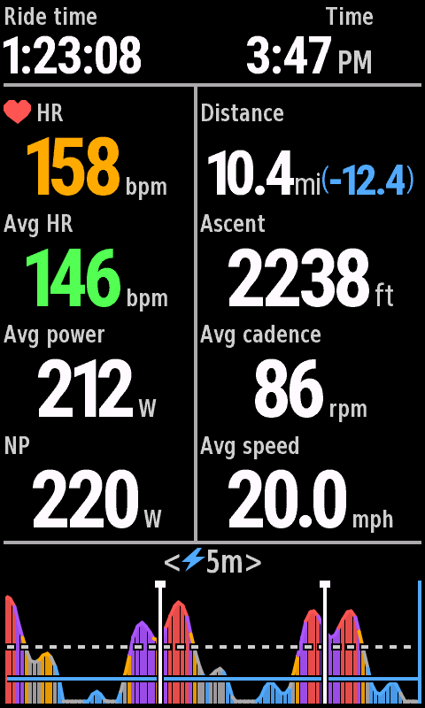

# v0.4.6 停止页八项全程统计验收

日期：2026-10-29。macOS、JDK17、Connect IQ SDK9.3.0；单字段全屏布局，合成数据。本轮USB未检测到Edge，未安装或验收实体设备，未上传或提交Connect IQ Store。

## 布局

顶部左侧为开始后的总经过时间（elapsedTime），右侧为当前12小时制时钟，包含完整AM/PM，仍为原生雷达提示预留右上角区域。中间复用左窄右宽的列宽，左列从上至下为实时心率、平均心率、全程平均功率、NP；右列为总距离、总爬升、全程平均踏频、全程平均速度。可用的导航剩余距离继续以蓝色括号保留。

停止页图表分隔线840参考由220移至246px，标题去掉爬升与时钟，仅保留居中范围切换；plotTop由254改为269px，底部不变。骑行页坐标不变。标题与统计标签使用附加的SummaryLabel14，原有字形及索引不变。ft和AM/PM继续使用原字号。

平均心率/功率沿用原生全程数据优先；平均踏频与平均速度直接使用Activity.Info.averageCadence/averageSpeed，计时开始前不显示原生上次活动残留，记录开始后的真实0值保留。[Garmin API](https://developer.garmin.com/connect-iq/api-docs/Toybox/Activity/Info.html)。NP仍为本地30秒滚动估算，记录不完整时标记NP est.，不显示Moving。

触屏机型的范围切换命中区域、蓝色反馈框以及左侧双击车铃区域跟随下移后的分隔线；最后一行统计不再落入旧图表点击区域。恢复骑行后使用原来的区域，保留选择与历史。按钮机型自动切换显示，保持5m默认范围，无触控功能。

## 构建与测试

12款live、test及停止页snapshot均顺序构建成功，无警告。原生VM通过510次测试执行：按钮机型每款35项，触屏机型每款45项。[逐设备记录](vm-matrix.json)。初版曾超过旧版运行环境的函数参数上限，最终共享绘制函数缩减参数并通过530/830兼容检查，未增加逐设备实现。

新增测试覆盖原生平均值的缺失/负值/0值/开始前残留过滤、平均速度单位转换、长时间与12:59AM时钟安全间距、长距离/五位爬升/四位功率、缺失数据、停止页底部点击不误切换、图表新区域与车铃区域恢复。既有NP、Zone、Lap、铃声两秒音效和骑行页输入测试继续通过。

Python共9项检查通过，新增四档停止页行间墨迹与图表标题边界检查；生成文件和全部字库像素/度量检查通过。[实际字段首帧堆](field-memory.json)为74,448–110,624 bytes，低于当时127,424上限。这是合成历史首帧，不代表长骑行峰值，也不使用测试VM的大堆推断实际余量。

## 原生状态切换与骑行回归

在Simulation → Activity Data中实际执行Start → Pause → Resume → Stop，导出[暂停](edge840-native-paused-night.png)、[恢复](edge840-native-resumed-night.png)、[停止](edge840-native-stopped-night.png)。暂停/停止进入新统计页，恢复回骑行页。回调打断采样连续性，暂停和停止相对固定快照各有1个图表像素差异；恢复后滚动功率进度及图表共10像素差异，均为采样重置行为。

840普通骑行页的日间、夜间相对v0.4.5均为0像素差异，确认顶部、实时信息、Lap/All、功率图及标题完全不变。[像素、尺寸与SHA256](pixel-checks.json)。

## 四种屏幕比例

File → Save Screen Capture原生导出，无反色或重绘。5款代表设备覆盖4种分辨率及530无触屏环境；全部复用SummaryRenderer与生成的SummaryLayout。

| 设备 | 日间 | 夜间 |
| --- | --- | --- |
| Edge 530 |  |  |
| Edge 840 |  |  |
| Edge 1040 |  |  |
| Edge 850 |  |  |
| Edge 1050 |  |  |

边界：[300.5mi(-200.5)、99999ft、四位功率、三位均踏频与100.5mph日间](edge840-stress-day.png) · [夜间](edge840-stress-night.png) · [缺失值日间](edge840-missing-day.png) · [夜间](edge840-missing-night.png)。

## 分发

[包清单](packages.json)。v0.4.6提供12个正式PRG、12个逐机型ZIP和完整ZIP，内容、CRC、许可证与SHA256校验通过。旧版本保留。签名IQ覆盖12机型/17个地区编号，位于本地dist/connect-iq/v0.4.6；本轮没有提交商店。
