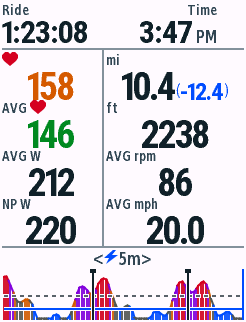
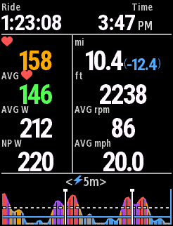
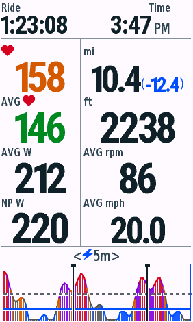
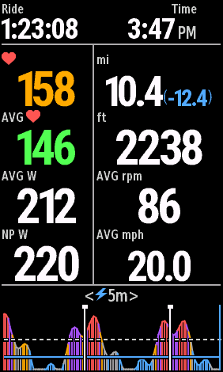
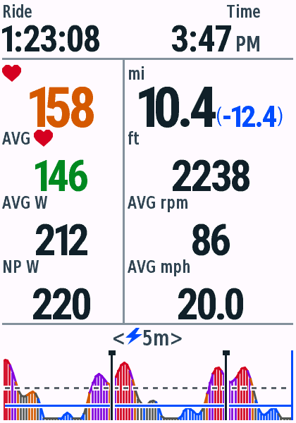
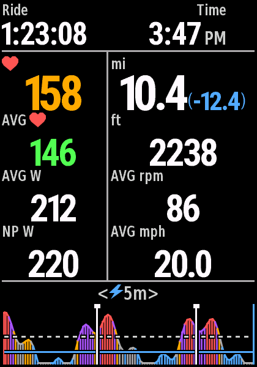
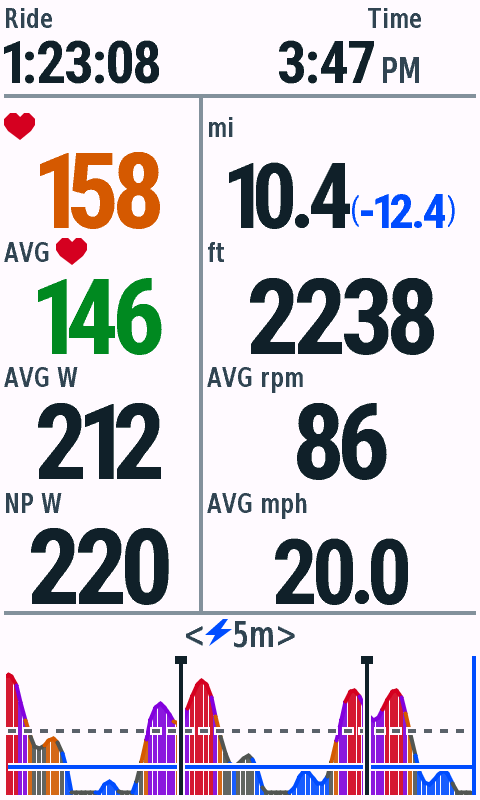
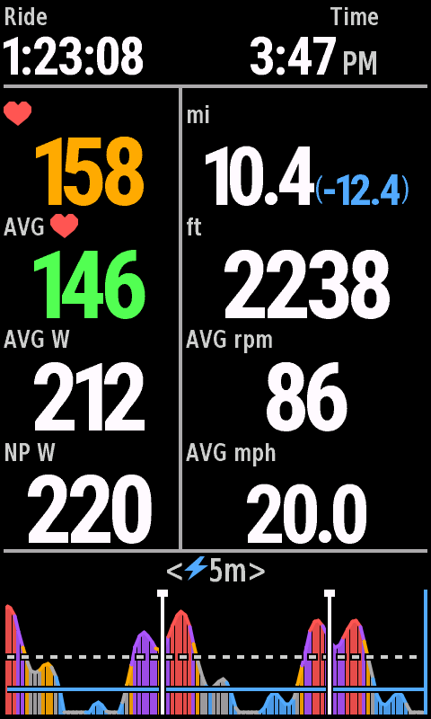

# v0.4.8 停止页精简与数字放大

日期：2026-10-29，Connect IQ SDK9.3.0 / JDK17 / macOS，单字段全屏，合成数据。骑行页及停止页的数据来源、状态切换、图表和手势不变。本轮不提交商店；USB安装情况见包记录。

## 布局

840停止页中部分隔线从x112左移到x102，右栏从128增至138px，左栏为98px。使用独立的SummaryLayout横向坐标，骑行页的分隔线与布局不动。标题Ride time缩短为Ride；当前心率仅用心形，平均心率用AVG + 心形，平均功率为AVG W，NP为NP W；估算时保留NP est W提示。右栏标签为mi、ft、AVG rpm、AVG mph，数字旁不再重复单位。

数值基线依次下移3个840参考像素，选择现有较大字形。整数优先使用完整粗体字形，带小数的值跳过不支持小数点的整数专用字库。840普通心率/功率/爬升数字字高由26增至28px，速度及短距离由22增至28px。较大屏幕优先复用现有饱满粗体数字，窄体保留为宽度回退，无新增字体位图。长读数按真实墨迹宽度逐级缩小，优先保留距离和剩余里程小数；剩余里程继续使用蓝色常规括号与加粗数字。

停止页单独允许省略行内mi的距离排版；骑行页仍保留原有单位和精度。两者复用相同的距离文本与回退逻辑。图表顶线、范围选择、手势边界和绘图区均未移动。

## 验证

12款机型546次原生测试与10项Python检查全部通过，36次live/test/snapshot构建无警告。840骑行页日夜和停止页功率图区日夜均为0像素差异。1030三档历史128点与100个Lap标记满容量场景完成原生Start → Pause → Resume。

[原生测试矩阵](vm-matrix.json) · [Python检查](python-tests.txt) · [字库一致性](font-checks.txt) · [字段首帧内存](field-memory.json) · [像素回归](pixel-checks.json) · [分发校验](packages.json)。

扩展现有测试，覆盖停止页独立列宽、普通数字增长、100.5速度小数点、300.5(-200.5)完整距离、缺失值、100小时和午夜时钟；既有暂停/恢复、触控、铃声、采样与NP检查保留。各屏幕比例使用原生File → Save Screen Capture导出，骑行页对v0.4.7做日夜像素回归。

| 设备 | 日间 | 夜间 |
| --- | --- | --- |
| Edge530 |  |  |
| Edge840 |  |  |
| Edge1040 |  |  |
| Edge850 |  |  |
| Edge1050 |  |  |

[长读数](edge840-stress-day.png) · [缺失值](edge840-missing-day.png) · [旧运行环境满容量](edge1030-capacity-day.png)。

当前字段首帧为74,608–98,840 bytes，1030固定满容量停止页首帧122,096 / 127,424 bytes；记录不代表真实长骑行峰值。[满容量恢复](edge1030-capacity-resumed-day.png)。
