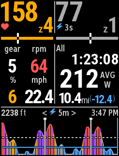
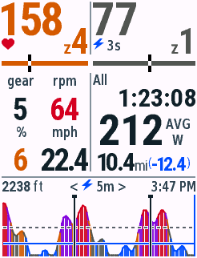
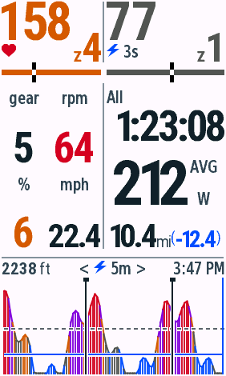
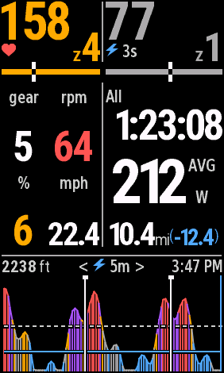
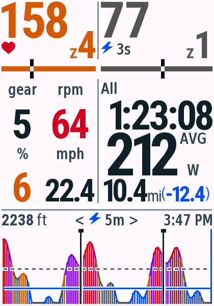
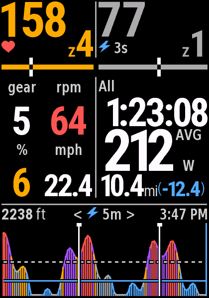
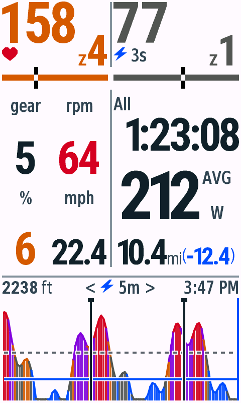
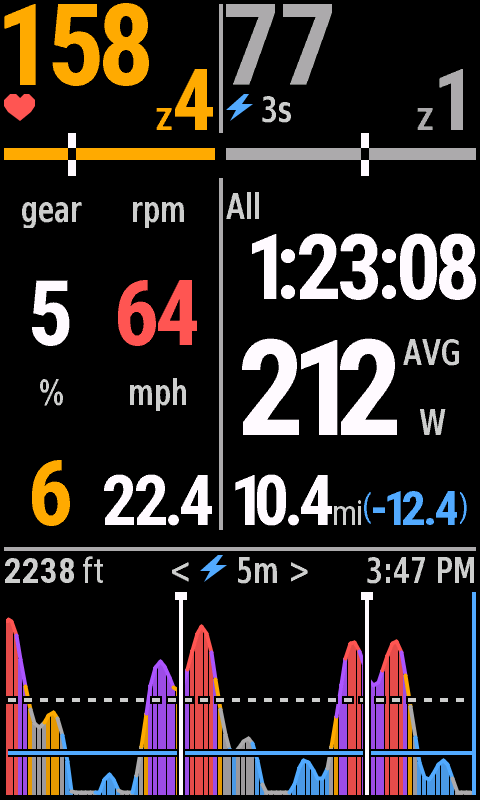

# v0.4.2 日夜主题验收

日期：2026-10-24。macOS、JDK17、Connect IQ SDK9.3.0。全部使用单字段全屏布局和合成数据；本轮未做实体设备日夜切换验收。

## 系统跟随

正式渲染器每次绘制读取原生[`DataField.getBackgroundColor()`](https://developer.garmin.com/connect-iq/api-docs/Toybox/WatchUi/DataField.html#getBackgroundColor-instance_function)，系统返回白色或黑色，直接选择相应色板。码表自身的自动日夜规则或手动选择决定背景，应用不另算日出日落、不新增权限或设置项。

模拟器中使用 Data Fields → Background Color → White / Black 改变原生背景值，运行的是与正式渲染器相同的 snapshot 程序。截图均由 File → Save Screen Capture 原生导出，未反色或修饰。

## 构建与测试

12 款机型的正式 live 和原生 test 程序均编译成功，VM 共通过 **381** 次测试执行：按钮机型每款25项，触屏机型每款34项。[逐机型记录](vm-matrix.json)。新增主题测试覆盖连续往返切换、日间颜色还原、功率/心率色系、踏频/坡度阈值、缺失值及图表背景混色。

Python共8项检查通过，包含原有布局与字体回归，以及两套色板的对比度和MIP色彩区分。夜间六种数据颜色对黑底对比度为5.45–15.82:1；普通文字为13.08–21:1。彩色色板使用64色RGB立方体，验证蓝、绿、橘、红、紫、灰彼此不同。对比度是源RGB色值的计算结果，不能替代实际背光和环境下的真机观察。

## 四种显示档与按钮机型

5款代表设备覆盖全部4个分辨率，以及530的旧版运行环境和无触屏默认视图。日间导出与v0.4.1画面均为 **0个不同像素**；840在同一实例中进行 White → Black → White 后也为0个不同像素。证明主题切换没有改变当前示例的文字、布局、统计和功率历史。[像素、尺寸、SHA256与实际字段首帧内存记录](pixel-checks.json)。

| 型号 | 日间 | 夜间 |
| --- | --- | --- |
| Edge 530 |  |  |
| Edge 840 |  |  |
| Edge 1040 |  |  |
| Edge 850 |  |  |
| Edge 1050 |  |  |

字体使用现有抗锯齿字库和原始裁剪规则，背景切换后没有白色字框。夜间Zone标记采用白色端点和黑色切口；FTP虚线、Z2蓝线与Lap标记使用黑色描边，保持从彩色柱形中可辨认。

## 安装包

v0.4.2提供12个机型的正式PRG、逐机型ZIP和完整ZIP，已检查内容、CRC、许可证及所有SHA256。版本目录保留v0.4.0和v0.4.1。签名IQ另导出全部17个地区产品编号，位于`dist/connect-iq/v0.4.2/FastRider-0.4.2.iq`，没有在本轮上传商店。

已提交审核的商店版本仍是v0.4.1；v0.4.2新增日夜主题，可从GitHub侧载安装。
