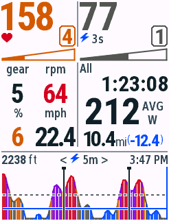
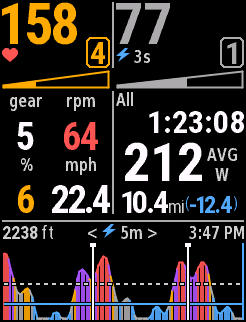
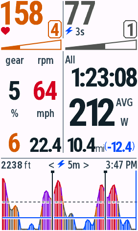
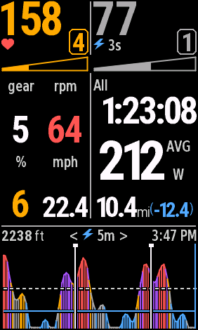
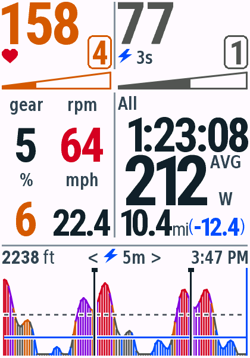
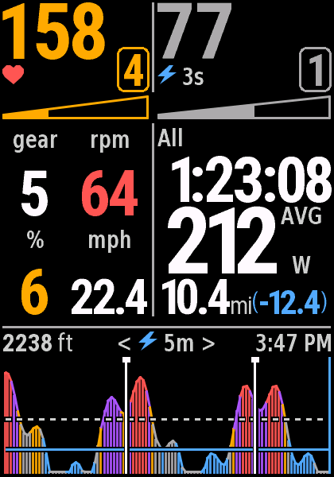
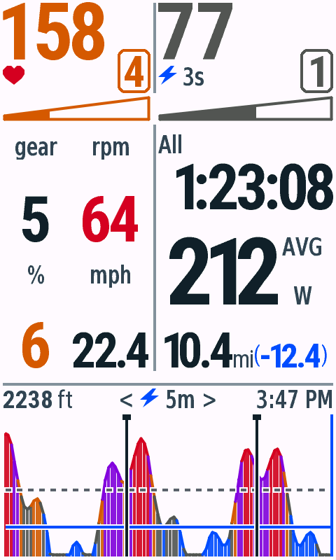
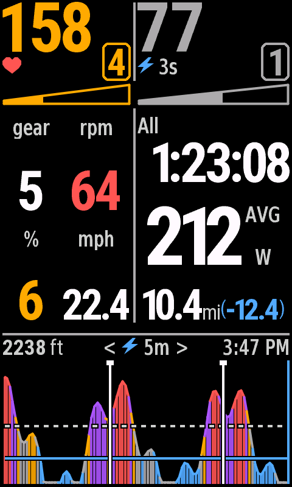

# v0.4.4 Zone 徽标与梯形进度验收

日期：2026-10-29。macOS、JDK17、Connect IQ SDK9.3.0。单字段全屏布局，合成数据。本轮USB未检测到Edge，没有安装或验收实体设备；没有上传或提交Connect IQ Store。

## 设计

仅改变骑行页的Zone外观：移除Z字母，编号放入同色圆角空心框。沿用现有数字字体，框线严格限制在其安全区域内；普通编号使用32号字库、四位主功率回退时用26号字库（840参考）。无数据用横线和中性颜色。

原实心横条与黑白竖线改为水平梯形：左细右粗，左侧实心、右侧空心，交界由原zoneFraction映射。840左右端高度约4px与18px，仍处于原marker的高度区域。轮廓与实心部分用相同分区颜色，空心区域保持当前日夜背景；继续使用平台原生图形抗锯齿。值缺失时没有实心部分；0%为空、100%为满；功率Z7无有限上界时沿用原有满格规则。

心率/功率分区算法、原生分区读取与备用Max HR规则均未改变。心率、功率主数字以及其他信息的字体、间距保持不变。停止页不使用Zone徽标或进度条。

## 构建与测试

12款设备live、test、默认snapshot均编译成功，无警告。原生VM通过465次测试执行：按钮机型每款32项，触屏机型每款41项。[逐设备汇总](vm-matrix.json)。新增验证0%、25%、50%、75%、100%、缺失值与越界钳制，所有分区在日夜模式绘制，数字与圆角框内边距、雷达预留区、梯形与中间信息区间距。现有触控、铃声、Lap、暂停恢复、NP及标题边界测试继续通过。

Python8项检查、生成文件检查、四档字库像素和字体度量检查通过。840字体资源SHA256不变。绘制逻辑全部共享，布局锚点由design/layout.json生成四档Layout，无逐机型分支。

## 像素检查

840相对v0.4.3的修改仅发生在两个Zone徽标及进度条区域：日间3484像素、夜间3487像素。允许区域以外均为0像素差异，确认主数字、图标、中间统计、功率图未改变。停止页日夜均为0像素差异。历史12组合基准继续保留；本版本对Zone区域的变更是有意设计更新。

用独立像素检查验证两种主题的普通实心/空心内部、满格和缺失值空心内部；没有通过重画或反色生成截图。[对比、尺寸、SHA256与填充检查记录](pixel-checks.json)。

## 原生截图

File → Save Screen Capture导出。覆盖全部12机型的日间默认页；以下代表设备同时覆盖全部4个屏幕尺寸与按钮机型的日夜显示。

| 设备 | 日间 | 夜间 |
| --- | --- | --- |
| Edge 530 |  |  |
| Edge 840 |  |  |
| Edge 1040 |  |  |
| Edge 850 |  |  |
| Edge 1050 |  |  |

边界：[四位功率日间](edge840-stress-day.png) · [夜间](edge840-stress-night.png) · [缺失值日间](edge840-missing-day.png) · [夜间](edge840-missing-night.png)。

停止页回归：[日间](edge840-stopped-day.png) · [夜间](edge840-stopped-night.png)。

全部机型的当前默认图已同步到[README画廊](../../../screenshots.md)。版本固定原图保存在本目录，不覆盖历史截图记录。

## 分发

v0.4.4包含12个正式PRG、12个单机型ZIP和完整ZIP，已验证内容、CRC、许可和SHA256。旧版本不变。[包清单](packages.json)。IQ覆盖12款机型/17个地区编号，位于本地dist/connect-iq/v0.4.4；本轮没有提交商店。
